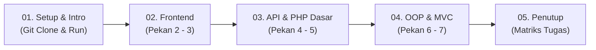

# Panduan & Naskah Siap Rekam Video Pengganti UTS (Pekan 2 - 7)
### Tim Pengembang Web J — Format Kelompok 3 Orang (Pembagian Rata & Berbobot)

Panduan ini adalah dokumen standar operasional (*Standard Operating Procedure*) untuk perekaman video **Tugas Pengganti UTS Pemrograman Web Kelas J**. Dokumen ini dirancang agar setiap anggota memiliki porsi yang rata, berbobot tinggi, dan mendemonstrasikan hasil eksekusi (*live output*) yang konsisten dari Pekan 2 hingga Pekan 7.

---

## 1. Aturan Mutlak Dosen & Strategi Eksekusi

| Ketentuan Dosen | Standar Eksekusi Video Kelompok Kita |
| :--- | :--- |
| **Layar Awal Wajib Git Clone** | Rekaman dimulai dari terminal kosong, menjalankan `git clone <url-repo>`, `cd`, cek `git log`, dan menjalankan server lokal PHP. |
| **Semakin Jelas & Lengkap, Nilai Semakin Bagus** | Membedah seluruh **Task 01, 02, dan 03 dari Week 2 hingga Week 7** secara sistematis, menghubungkan potongan kode dengan hasil visual di browser. |
| **Hasil Running Harus Terlihat Nyata** | Setiap anggota mendemonstrasikan output langsung di peramban (`http://localhost:8000/...`) tanpa rekayasa. |
| **Pembagian Kode Tidak Boleh Sama** | Kode dibagi tegas per-layer: Frontend UI/DOM (W2-3), API & Core PHP (W4-5), dan OOP/MVC Architecture (W6-7). |
| **Platform Pengumpulan** | YouTube Publik (bukan unlisted/private), batas akhir pengumpulan **7 November 2026 pukul 20:00 WIB**. |

---

## 2. Roadmap Presentasi & Matriks Pembagian Tugas

### 2.1 Alur Video (Pipeline Ringkas)



### 2.2 Tabel Pembagian Tugas & Baris Kode Kunci

| Anggota | Peran | Pekan | Berkas & Baris Kode yang Dibuka di VS Code | Fokus Live Demo di Browser |
| :--- | :--- | :--- | :--- | :--- |
| **Anggota 1** | Frontend & DOM Engineer | **Pekan 2 & 3** | • `frontend/index.html` (Baris 12–28, 31–47, 64–66)<br>• `frontend/script.js` (Baris 9–16, 17–53, 77–124) | • Responsivitas (Desktop 3 kolom $\leftrightarrow$ HP 2 kolom)<br>• Filter kategori & pencarian realtime<br>• Paginasi dinamis (+4 kartu) |
| **Anggota 2** | API & Core PHP Engineer | **Pekan 4 & 5** | • `frontend/script.js` (Baris 132–158)<br>• `backend/data/data_menu.php` (Baris 1–25)<br>• `backend/helpers/functions.php` (Baris 3–23)<br>• `backend/api.php` (Baris 1–13) | • Respon REST API JSON di `backend/api.php`<br>• Filter parameter JSON `?kategori=Makanan`<br>• Helper `formatRupiah()` & Empty State UI |
| **Anggota 3 (Lead)** | Lead Architect, OOP & MVC | **Pekan 6 & 7** | • `backend/classes/Menu.php` (Baris 3–26, 28–76, 89–124)<br>• `backend/index.php` (Baris 1–12)<br>• `backend/controllers/MenuController.php` (Baris 14–38)<br>• `backend/models/MenuModel.php` (Baris 17–49)<br>• `backend/views/menu/show.php` (Baris 36–63) | • Git clone & spin-up server PHP di terminal<br>• Katalog MVC di `backend/index.php`<br>• Rute detail Controller `?action=show&id=1`<br>• Penanganan ID salah `?action=show&id=999` |

### 2.3 Rincian Tugas & Baris Kode per Anggota

#### 👤 Anggota 1 — Frontend UI & Interaktivitas DOM (Pekan 2 & 3)
* **Pekan 2 (`frontend/index.html`):**
  * `Baris 12–28`: Konfigurasi tema Tailwind CSS kustom (warna *earthy warm* & font).
  * `Baris 31–47`: Struktur HTML5 semantik (`<main>`, judul, search input, filter bar, kontainer grid responsive `grid-cols-2 lg:grid-cols-3`).
  * `Baris 64–66`: Komponen tombol paginasi `#navigasi`.
* **Pekan 3 (`frontend/script.js`):**
  * `Baris 9–16`: Penyeleksian DOM element (`getElementById`, `querySelectorAll`).
  * `Baris 17–53`: Fungsi `renderMenu()` & template dynamic HTML card.
  * `Baris 77–108`: Event listener tombol filter kategori dan paginasi progresif (+4 kartu).
  * `Baris 110–124`: Event listener pencarian input realtime (`keyup` & `input`).
* **Live Demo:** Buka `http://localhost:8000/frontend/index.html` $\rightarrow$ uji responsif (F12) $\rightarrow$ klik filter *"Minuman"* $\rightarrow$ ketik search *"kopi"* $\rightarrow$ klik *"Lihat Lebih Banyak"*.

#### 👤 Anggota 2 — Integrasi REST API & PHP Prosedural (Pekan 4 & 5)
* **Pekan 4 (`frontend/script.js`):**
  * `Baris 132–158`: Fungsi `ambilDataMenu()` dengan `async/await` dan `fetch('../backend/menu.json')`.
  * `Baris 133–138 & 151–157`: Siklus status API (*Loading State* spinner, *Success State*, dan *Error State*).
  * `Baris 54–59`: Logika *Empty State* ketika hasil pencarian kosong.
* **Pekan 5 (`backend/data/` & `backend/helpers/`):**
  * `backend/data/data_menu.php` (`Baris 1–25`): Master data 30 item dalam array asosiatif multidimensi.
  * `backend/helpers/functions.php` (`Baris 3–23`): Fungsi helper murni: `formatRupiah()`, `saringMenu()`, `saringMenuByKategori()`.
  * `backend/api.php` (`Baris 1–13`): Endpoint REST API JSON berstandar modern (`header('Content-Type: application/json')` & `json_encode`).
* **Live Demo:** Buka `http://localhost:8000/backend/api.php` $\rightarrow$ uji filter `?kategori=Makanan` $\rightarrow$ uji Empty State di frontend dengan mengetik kata acak.

#### 👤 Anggota 3 (Lead) — OOP, Arsitektur MVC & Integrasi (Pekan 6 & 7)
* **Opening:** Layar terminal `git clone`, periksa `git log`, inisialisasi server `php -S localhost:8000`.
* **Pekan 6 (`backend/classes/Menu.php`):**
  * `Baris 3–26`: Blueprint Class `Menu`, 6 properti `private`, dan konstruktor `__construct()`.
  * `Baris 28–56 & 58–76`: Getter methods dan helper method bisnis (`getHargaFormatted()`, `isBestSeller()`, dll).
  * `Baris 89–124`: Method enkapsulasi rendering kartu `renderKartu(): string`.
* **Pekan 7 (`backend/` MVC Core):**
  * `backend/index.php` (`Baris 1–12`): Front Controller Router yang membaca `?action=...`.
  * `backend/controllers/MenuController.php` (`Baris 14–38`): Method kendali `index()` dan `show()`.
  * `backend/models/MenuModel.php` (`Baris 17–49`): Layer Model query data & pembungkusan ke objek `Menu`.
  * `backend/views/menu/show.php` (`Baris 36–63`): Template view detail produk terisolasi & penanganan kondisi 404 item kosong.
* **Live Demo:** Buka `http://localhost:8000/backend/index.php` (katalog MVC) $\rightarrow$ filter server `?kategori=Minuman` $\rightarrow$ rute detail `?action=show&id=1` $\rightarrow$ rute error `?action=show&id=999`.
* **Closing:** Paparkan rekapitulasi kontribusi anggota kelompok.

---

## 3. Naskah Siap Rekam Kata-per-Kata (Sinkron: Kode $\leftrightarrow$ Suara $\leftrightarrow$ Output Browser)

---

### SEGMENT 1: PEMBUKAAN & INISIALISASI GIT CLONE (Anggota 3 / Lead)
* **Total Durasi:** ~1.5 Menit

#### 🔹 Langkah 1.1: Git Clone & Verifikasi Riwayat Commit
* **Aksi Layar (Terminal):**
  1. Tampilkan Terminal kosong (PowerShell/CMD).
  2. Ketik: `git clone https://github.com/<username>/<nama-repo>.git` lalu tekan Enter.
  3. Ketik: `cd "tugas pemrograman web"`
  4. Ketik: `git log --oneline -n 10`
* **Naskah Bicara (Anggota 3):**
  > *"Assalamu’alaikum warahmatullahi wabarakatuh. Selamat pagi/siang kepada Bapak Dosen Rezha Rivai dan rekan-rekan sekalian. Kami dari tim pengembang kelas Web J ingin mempresentasikan pengerjaan **Tugas Pengganti UTS Pemrograman Web** dengan tema proyek: **Web Pemesanan Makanan & Minuman Cafe Berbasis QR Code**.*
  > 
  > *Sesuai ketentuan instruksi tugas, rekaman kami awali dengan pembuktian inisialisasi lingkungan melalui `git clone` repositori GitHub resmi kami secara live di terminal. Melalui perintah `git log`, dapat terlihat catatan commit bertahap yang membuktikan rekam jejak pengerjaan kami dari Pekan 2 hingga Pekan 7."*

#### 🔹 Langkah 1.2: Membuka Editor & Spin-up Server Lokal PHP
* **Aksi Layar (Terminal & VS Code):**
  1. Di terminal ketik: `code .` (membuka VS Code).
  2. Di terminal VS Code jalankan: `php -S localhost:8000`
* **Naskah Bicara (Anggota 3):**
  > *"Untuk menguji aplikasi secara lokal, kami menjalankan server bawaan PHP 8.3 pada port 8000. Sistem ini kami kembangkan dengan arsitektur modular yang memadukan Client-Side SPA pada folder `frontend/` dan Server-Side MVC pada folder `backend/`.*
  > 
  > *Untuk penjelasan teknis Pekan 2 dan Pekan 3, akan dipaparkan secara mendalam oleh rekan saya, [Nama Anggota 1]."*

---

### SEGMENT 2: PEKAN 2 & 3 — FRONTEND UI & INTERAKSI DOM (Anggota 1)
* **Total Durasi:** ~3.5 Menit

#### 🔹 Langkah 2.1: Pekan 2 — UI Semantik & Sistem Desain Tailwind CSS
* **Aksi Layar (VS Code):**
  1. Buka file `frontend/index.html`.
  2. Sorot **Baris 31–47** (tag semantik `<main>`, input search, filter bar, kontainer grid).
  3. Sorot **Baris 12–28** (konfigurasi tema Tailwind CSS: warna *earthy warm* & font).
* **Naskah Bicara (Anggota 1):**
  > *"Terima kasih [Nama Anggota 3]. Saya [Nama Anggota 1, NIM] bertanggung jawab atas rekayasa antarmuka pengguna pada **Pekan 2** dan **Pekan 3** di folder `frontend/`.*
  > 
  > *Pada **Pekan 2: UI Semantik & Sistem Desain Responsif**, kita buka `frontend/index.html`. Di baris 31–47 kami menyusun dokumen semantik standar menggunakan tag `<main>` sebagai kontainer utama produk dan elemen identitas form yang jelas untuk aksesibilitas.*
  > 
  > *Kemudian di baris 12–28, kami mengonfigurasi tema warna bernuansa hangat (earthy warm) Tailwind CSS serta tata letak grid responsif: 2 kolom untuk ponsel dan 3 kolom untuk desktop tanpa overflow horizontal."*
* **Aksi Layar (Browser):**
  1. Buka peramban ke: `http://localhost:8000/frontend/index.html`.
  2. Tekan tombol `F12` (Inspect Element) $\rightarrow$ aktifkan toggle device emulator (layar HP: terlihat 2 kolom), lalu kembalikan ke layar desktop (terlihat 3 kolom).
* **Naskah Bicara (Anggota 1):**
  > *"Bisa kita buktikan langsung di peramban: ketika ukuran layar beralih ke mode mobile, tata letak otomatis beradaptasi menjadi 2 kolom, dan saat kembali ke ukuran desktop menjadi 3 kolom secara rapi."*

#### 🔹 Langkah 2.2: Pekan 3 — DOM Selection & Event Search Interaktif
* **Aksi Layar (VS Code):**
  1. Buka file `frontend/script.js`.
  2. Sorot **Baris 9–16** (penyeleksian elemen DOM via `getElementById`).
  3. Sorot **Baris 77–94** (event click pada tombol kategori filter).
  4. Sorot **Baris 110–124** (event listener realtime search `keyup` dan `input`).
* **Naskah Bicara (Anggota 1):**
  > *"Melangkah ke **Pekan 3: Arsitektur DOM & Interaksi Berbasis Event**, di file `script.js` baris 9–16 kami menyeleksi elemen DOM menggunakan `getElementById`. Di baris 77–94 kami memasang event listener click pada tombol kategori filter, dan di baris 110–124 kami menangani input event pada search bar untuk menyaring menu secara realtime."*
* **Aksi Layar (Browser):**
  1. Di tab browser `frontend/index.html`, klik tombol filter **"Minuman"** $\rightarrow$ daftar menu tersaring.
  2. Ketikkan kata **"kopi"** pada search bar lalu tekan `Enter` $\rightarrow$ kartu menu menyaring varian kopi.
  3. Hapus teks pencarian $\rightarrow$ tampilan kembali normal.
* **Naskah Bicara (Anggota 1):**
  > *"Di peramban hasilnya sangat instan: saat tombol 'Minuman' diklik, kartu menu langsung tersaring seketika. Dan saat saya mengetik kata 'kopi', DOM secara realtime memfilter kartu yang relevan tanpa me-reload halaman."*

#### 🔹 Langkah 2.3: Pekan 3 — Dynamic Progressive Pagination
* **Aksi Layar (VS Code):**
  1. Di file `frontend/script.js`, sorot **Baris 96–108** (fungsi event click paginasi tombol `#navigasi`).
* **Naskah Bicara (Anggota 1):**
  > *"Masih di Pekan 3, pada baris 96–108 kami membangun mesin paginasi dinamis. Tombol 'Lihat Lebih Banyak' akan menambah kuota 4 kartu setiap kali diklik dan bertransformasi menjadi 'Tutup Kembali' jika seluruh data dalam kategori telah terbuka."*
* **Aksi Layar (Browser):**
  1. Klik kategori **"All"** $\rightarrow$ scroll ke bawah.
  2. Klik tombol **"Lihat Lebih Banyak"** 2 kali $\rightarrow$ perlihatkan kuota kartu bertambah dan teks tombol berubah jadi **"Tutup Kembali"**.
* **Naskah Bicara (Anggota 1):**
  > *"Terbukti di browser: saat tombol 'Lihat Lebih Banyak' diklik, 4 kartu baru muncul secara dinamis, dan begitu semua item terbuka teks tombol berubah menjadi 'Tutup Kembali'. Selanjutnya, penjelasan Pekan 4 dan Pekan 5 akan dilanjutkan oleh rekan saya, [Nama Anggota 2]."*

---

### SEGMENT 3: PEKAN 4 & 5 — REST API ASINKRON & DASAR SERVER-SIDE PHP (Anggota 2)
* **Total Durasi:** ~3.5 Menit

#### 🔹 Langkah 3.1: Pekan 4 — Integrasi Fetch API & Siklus Status Jaringan
* **Aksi Layar (VS Code):**
  1. Buka file `frontend/script.js`.
  2. Sorot **Baris 132–158** (fungsi `ambilDataMenu()` berbasis `async/await` dan `fetch('../backend/menu.json')`).
  3. Tunjukkan penanganan siklus status: **Baris 133–138** (*Loading State*), **Baris 54–59** (*Empty State*), dan **Baris 151–157** (*Error State* di blok `catch`).
* **Naskah Bicara (Anggota 2):**
  > *"Terima kasih [Nama Anggota 1]. Saya [Nama Anggota 2, NIM] bertanggung jawab atas integrasi data asinkron pada **Pekan 4** dan fondasi server-side pada **Pekan 5**.*
  > 
  > *Pada **Pekan 4: Integrasi REST API & Manajemen Status Asinkron**, di file `script.js` baris 132–158 kami menerapkan pemanggilan jaringan asinkron menggunakan `async/await` dan `fetch()`. Ini memisahkan data sepenuhnya dari antarmuka.*
  > 
  > *Kami juga mengelola siklus status jaringan secara lengkap: animasi putar saat Loading di baris 133, dan isolasi galat jaringan di blok catch baris 151."*
* **Aksi Layar (Browser):**
  1. Di tab browser `frontend/index.html`, ketikkan kata kunci acak yang tidak ada di menu: **"zzzz"** lalu tekan `Enter`.
* **Naskah Bicara (Anggota 2):**
  > *"Dapat kita lihat di browser: ketika data yang dicari tidak ditemukan, antarmuka menangani kondisi tersebut secara anggun dengan menampilkan Empty State: 'Yang kamu cari tidak ditemukan'."*

#### 🔹 Langkah 3.2: Pekan 5 — Master Data PHP & Pure Helper Functions
* **Aksi Layar (VS Code):**
  1. Buka file `backend/data/data_menu.php` $\rightarrow$ Sorot **Baris 1–25** (master data 30 item menu dalam array asosiatif multidimensi).
  2. Buka file `backend/helpers/functions.php` $\rightarrow$ Sorot **Baris 3–6** (`formatRupiah`) dan **Baris 8–23** (`saringMenu` & `saringMenuByKategori`).
* **Naskah Bicara (Anggota 2):**
  > *"Beralih ke **Pekan 5: Pemrosesan Server-Side (Procedural PHP)**, kami mulai memindahkan beban ke server. Di `backend/data/data_menu.php` baris 1–25 kami menyusun 30 data produk dalam array multidimensi.*
  > 
  > *Kemudian di `backend/helpers/functions.php` baris 3–23, kami membuat fungsi murni prosedural seperti `formatRupiah()` untuk standarisasi format rupiah serta fungsi `saringMenu()` untuk menyaring data array secara modular."*

#### 🔹 Langkah 3.3: Pekan 5 — Eksekusi Endpoint REST API Backend
* **Aksi Layar (VS Code):**
  1. Buka file `backend/api.php` $\rightarrow$ Sorot **Baris 1–13** (header `Content-Type: application/json`, query parameter `$_GET['kategori']`, dan `echo json_encode()`).
* **Naskah Bicara (Anggota 2):**
  > *"Di file `backend/api.php` baris 1–13, kami membangun endpoint REST API murni yang mengonversi array master PHP menjadi respons JSON berstandar modern."*
* **Aksi Layar (Browser):**
  1. Buka tab baru di browser: `http://localhost:8000/backend/api.php` $\rightarrow$ perlihatkan struktur JSON yang rapi.
  2. Tambahkan parameter filter di URL: `http://localhost:8000/backend/api.php?kategori=Makanan` $\rightarrow$ perlihatkan data JSON tersaring khusus makanan.
* **Naskah Bicara (Anggota 2):**
  > *"Di peramban terbukti: endpoint `backend/api.php` sukses menyajikan data JSON yang bersih. Ketika kita menambahkan parameter `?kategori=Makanan`, server langsung menyaring array data khusus makanan secara dinamis. Tahap evolusi selanjutnya ke OOP dan MVC akan dipaparkan oleh rekan saya, [Nama Anggota 3]."*

---

### SEGMENT 4: PEKAN 6 & 7 — OOP & ARSITEKTUR MVC ENTERPRISE (Anggota 3 / Lead)
* **Total Durasi:** ~4.5 Menit

#### 🔹 Langkah 4.1: Pekan 6 — Object-Oriented Programming (Class Menu & Encapsulation)
* **Aksi Layar (VS Code):**
  1. Buka file `backend/classes/Menu.php`.
  2. Sorot **Baris 3–26** (definisi Class `Menu`, 6 properti `private`, dan konstruktor `__construct()`).
  3. Sorot **Baris 28–56** (lapisan public getter methods).
  4. Sorot **Baris 89–124** (method enkapsulasi rendering kartu `renderKartu(): string`).
* **Naskah Bicara (Anggota 3):**
  > *"Terima kasih [Nama Anggota 2]. Saya [Nama Anggota 3, NIM] akan memaparkan puncak evolusi sistem kami pada **Pekan 6** dan **Pekan 7**.*
  > 
  > *Pada **Pekan 6: Object-Oriented Programming (OOP)**, di file `classes/Menu.php` baris 3–26 kami membangun blueprint Class `Menu` dengan 6 atribut bertipe data ketat yang dienkapsulasi secara `private`. Akses data dijamin aman melalui getter methods di baris 28–56.*
  > 
  > *Di baris 89–124, logika komponen visual kartu kami kapsulasikan di dalam method `renderKartu()` yang secara otomatis mengevaluasi badge Best Seller, Promo, maupun status Habis."*

#### 🔹 Langkah 4.2: Pekan 7 — Arsitektur Model-View-Controller (MVC)
* **Aksi Layar (VS Code):**
  1. Perlihatkan struktur explorer folder `backend/`: `controllers/`, `models/`, `views/menu/`, dan `index.php`.
  2. Buka `backend/index.php` $\rightarrow$ Sorot **Baris 1–12** (Front Controller Router yang ramping).
  3. Buka `backend/controllers/MenuController.php` $\rightarrow$ Sorot **Baris 14–27** (method `index()`) dan **Baris 29–38** (method `show()`).
  4. Buka `backend/models/MenuModel.php` $\rightarrow$ Sorot **Baris 17–31** (`ambilSemua()`) dan **Baris 33–49** (`cariById()`).
  5. Buka `backend/views/menu/show.php` $\rightarrow$ Sorot **Baris 36–63** (template view detail produk).
* **Naskah Bicara (Anggota 3):**
  > *"Puncaknya pada **Pekan 7: Arsitektur Model-View-Controller (MVC)** dengan pemisahan tugas yang sangat ketat:*
  > * *Di `backend/index.php` baris 1–12, berkas ini bertindak sebagai Front Controller Router yang membaca parameter `action`.*
  > * *Di `MenuController.php` baris 14–38, controller mengorkestrasi alur HTTP: method `index()` menyajikan katalog, dan method `show()` menangani routing detail produk.*
  > * *Di `MenuModel.php` baris 17–49, model mengabstraksi data dan membungkusnya ke dalam koleksi objek `Menu`.*
  > * *Dan di folder `views/menu/`, view `show.php` murni menampilkan antarmuka detail tanpa logika query."*

#### 🔹 Langkah 4.3: Pekan 7 — Live Demo Output MVC (Katalog, Filter Server & Rute Detail)
* **Aksi Layar (Browser):**
  1. Buka peramban ke: `http://localhost:8000/backend/index.php` (menampilkan katalog lengkap MVC).
  2. Klik filter tab **"Minuman"** pada katalog MVC $\rightarrow$ URL otomatis menjadi `?kategori=Minuman` dan data tersaring server-side.
  3. Buka rute detail item: `http://localhost:8000/backend/?action=show&id=1` $\rightarrow$ perlihatkan tampilan detail produk lengkap dari `views/menu/show.php`.
  4. Buka rute detail dengan ID salah: `http://localhost:8000/backend/?action=show&id=999` $\rightarrow$ perlihatkan penanganan graceful error: *"Item Tidak Ditemukan"*.
* **Naskah Bicara (Anggota 3):**
  > *"Pembuktian langsung di peramban: alamat `backend/index.php` berjalan murni di atas arsitektur MVC. Ketika kita memilih filter 'Minuman', server menangani query string `?kategori=Minuman` secara server-side.*
  > 
  > *Saat rute detail `?action=show&id=1` dibuka, Controller memicu method `show()` dan me-render template view detail yang anggun. Bahkan jika ID tidak valid seperti `id=999`, view show.php menangani kondisi kosong secara aman tanpa galat server."*

---

### SEGMENT 5: PENUTUP & PEMBAGIAN KONTRIBUSI ANGGOTA (Wajib Sesuai Rubrik Dosen)
* **Total Durasi:** ~2 Menit
* **Aksi Layar:**
  Tampilkan dokumen tabel rekapitulasi kontribusi anggota (Bagian 2.2 / slide) di layar secara penuh dan jelas.
* **Naskah Bicara (Dibacakan Anggota 3):**
  > *"Sebagai penutup video dan untuk memenuhi instruksi mutlak dosen terkait pembagian tugas masing-masing anggota yang tidak boleh sama, berikut adalah rekapitulasi kepemilikan kode kelompok kami:*
  > 
  > 1. *Pertama, **[Nama Anggota 1 - NIM]** sebagai **Frontend UI & DOM Engineer**, bertanggung jawab penuh atas struktur semantik HTML5 dan sistem responsif Tailwind CSS pada Pekan 2, serta manipulasi DOM dan event search interaktif pada Pekan 3.*
  > 2. *Kedua, **[Nama Anggota 2 - NIM]** sebagai **API & Server-Side Core Engineer**, bertanggung jawab penuh atas integrasi asinkron Fetch API dan manajemen status jaringan pada Pekan 4, serta struktur array master data dan fungsi helper sanitasi prosedural PHP pada Pekan 5.*
  > 3. *Ketiga, **[Nama Anggota 3 - NIM]** sebagai **Lead Architect, OOP & MVC Engineer**, bertanggung jawab atas inisialisasi lingkungan Git dan server, konstruksi Class entitas Menu berorientasi objek pada Pekan 6, serta arsitektur enterprise Model-View-Controller, Front Controller routing, dan View templates pada Pekan 7.*
  > 
  > *Seluruh source code telah diunggah ke repositori GitHub kami dan dokumentasi komprehensif dari Week 2 hingga Week 7 dapat diakses pada berkas README.md.*
  > 
  > *Demikian presentasi tugas pengganti UTS dari kelompok kami. Terima kasih banyak atas perhatian Bapak Rezha Rivai. Wassalamu’alaikum warahmatullahi wabarakatuh."*


---

## 4. Panduan Teknis Rekaman (Anti-Gagal)

1. **Persiapan:** Pastikan Laragon/PHP sudah terpasang. Cek di terminal dengan `php -v`.
2. **Koneksi Server:** Di terminal VS Code, jalankan perintah:
   ```bash
   php -S localhost:8000
   ```
3. **Perekaman Layar:**
   * Buka Google Meet / Zoom bertiga.
   * Anggota 3 (Lead) bertugas melakukan **Share Screen** pada resolusi 1080p.
   * Gunakan software **OBS Studio** atau fitur rekam bawaan meeting.
   * Masing-masing anggota membaca naskah sesuai gilirannya sambil Anggota 3 mengklik file dan membuka peramban sesuai panduan aksi layar.
4. **Tips Bila Salah Bicara:** Jangan stop rekaman. Anggota yang keliru cukup diam 2 detik, lalu ulangi kalimat dari awal. Bagian yang salah tinggal dipotong di CapCut/editor video.

---

## 5. Format Pengumpulan Google Form & Deskripsi YouTube

### Isian Formulir Google Form:
* **Tema:** Web Pemesanan Makanan & Minuman Cafe Berbasis QR Code (Evolusi Arsitektur: Client-Side SPA & Clean MVC PHP 8.3)
* **NIM - Nama:** 
  * [NIM Anggota 1] - [Nama Lengkap Anggota 1]
  * [NIM Anggota 2] - [Nama Lengkap Anggota 2]
  * [NIM Anggota 3] - [Nama Lengkap Anggota 3]
* **Link GitHub:** `https://github.com/<username>/<repo>`
* **Link Video YouTube:** `https://youtu.be/...` *(Wajib disetel **Public**)*

### Deskripsi Video YouTube (Tinggal Salin):
```text
TUGAS PENGGANTI UTS PEMROGRAMAN WEB (KELAS J)
Universitas Muhammadiyah Malang
Dosen Pengampu: Rezha Rivai, S.Kom., M.Cs.

Tema Proyek: Web Pemesanan Makanan & Minuman Cafe Berbasis QR Code
Arsitektur Sistem: Dual-Engine Architecture (Client-Side SPA & Server-Side MVC PHP 8.3)
Repositori GitHub: https://github.com/<username>/<repo>

ANGGOTA KELOMPOK & PEMBAGIAN KONTRIBUSI:
1. [NIM Anggota 1] - [Nama Lengkap Anggota 1]
   Peran: Frontend UI & DOM Engineer
   Kontribusi: Implementasi Pekan 2 (Semantic HTML5 & Responsive Tailwind CSS) dan Pekan 3 (DOM Selection & Event Search Interactivity).
   Berkas: frontend/index.html, frontend/script.js

2. [NIM Anggota 2] - [Nama Lengkap Anggota 2]
   Peran: API & Server-Side Core Engineer
   Kontribusi: Implementasi Pekan 4 (Fetch API Asinkron & Network State Management) dan Pekan 5 (PHP Procedural, Master Data Array & Helper Functions).
   Berkas: frontend/script.js, backend/data/data_menu.php, backend/helpers/functions.php, backend/api.php

3. [NIM Anggota 3] - [Nama Lengkap Anggota 3]
   Peran: Lead Architect, OOP & MVC Engineer
   Kontribusi: Inisialisasi Git & Environment Server, Implementasi Pekan 6 (OOP Entity Class Menu & Enkapsulasi), dan Pekan 7 (Enterprise MVC Architecture, Front Controller Routing, Model, Controller & View).
   Berkas: backend/classes/Menu.php, backend/index.php, backend/controllers/MenuController.php, backend/models/MenuModel.php, backend/views/menu/

TIMESTAMPS / CHAPTERS:
00:00 Inisialisasi Layar & Git Clone Repositori
01:30 Pekan 2: Struktur Semantic HTML5 & Sistem Desain Tailwind CSS
03:15 Pekan 3: Arsitektur DOM Selection & Interaksi Event Search
05:10 Pekan 4: Asynchronous Programming & Manajemen Status Fetch API
07:05 Pekan 5: Pemrosesan Server-Side PHP Prosedural & Helper Functions
08:50 Pekan 6: Object-Oriented Programming (Class Menu & Enkapsulasi)
10:45 Pekan 7: Arsitektur Model-View-Controller (Router, Controller, View)
13:15 Demonstrasi Live Output Sistem
14:30 Rekapitulasi Pembagian Kode Masing-Masing Anggota
```

