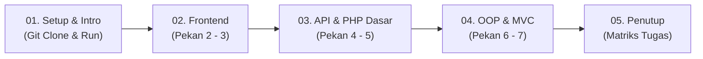

# Panduan & Naskah Siap Rekam Video Pengganti UTS (Pekan 2 - 7)
### Tim Pengembang Web J — Format Kelompok 3 Orang (Pembagian Rata & Berbobot)

Panduan ini adalah dokumen standar operasional (*Standard Operating Procedure*) untuk perekaman video **Tugas Pengganti UTS Pemrograman Web Kelas J**. Dokumen ini dirancang agar setiap anggota memiliki porsi yang rata, berbobot tinggi, dan mendemonstrasikan hasil eksekusi (*live output*) yang konsisten dari Pekan 2 hingga Pekan 7.

---

## 1. Aturan Mutlak Dosen & Strategi Eksekusi

| Ketentuan Dosen | Standar Eksekusi Video Kelompok Kita |
| :--- | :--- |
| **Layar Awal Wajib Git Clone** | Rekaman dimulai dari terminal kosong, menjalankan `git clone <url-repo>`, `cd`, cek `git log`, dan menjalankan server lokal PHP. |
| **Semakin Jelas & Lengkap, Nilai Semakin Bagus** | Membedah seluruh **Task 01, 02, dan 03 dari Week 2 hingga Week 7** secara sistematis, menghubungkan potongan kode dengan hasil visual di browser. |
| **Hasil Running Harus Terlihat Nyata** | Setiap anggota mendemonstrasikan output langsung di peramban (`http://localhost:8000/...`) tanpa rekayasa. |
| **Pembagian Kode Tidak Boleh Sama** | Kode dibagi tegas per-layer: Frontend UI/DOM (W2-3), API & Core PHP (W4-5), dan OOP/MVC Architecture (W6-7). |
| **Platform Pengumpulan** | YouTube Publik (bukan unlisted/private), batas akhir pengumpulan **7 November 2026 pukul 20:00 WIB**. |

---

## 2. Roadmap Presentasi & Matriks Pembagian Tugas

### 2.1 Alur Video (Pipeline Ringkas)



### 2.2 Tabel Pembagian Tugas & Baris Kode Kunci

| Anggota | Peran | Pekan | Berkas & Baris Kode yang Dibuka di VS Code | Fokus Live Demo di Browser |
| :--- | :--- | :--- | :--- | :--- |
| **Anggota 1** | Frontend & DOM Engineer | **Pekan 2 & 3** | • `frontend/index.html` (Baris 12–28, 31–47, 64–66)<br>• `frontend/script.js` (Baris 9–16, 17–53, 77–124) | • Responsivitas (Desktop 3 kolom $\leftrightarrow$ HP 2 kolom)<br>• Filter kategori & pencarian realtime<br>• Paginasi dinamis (+4 kartu) |
| **Anggota 2** | API & Core PHP Engineer | **Pekan 4 & 5** | • `frontend/script.js` (Baris 132–158)<br>• `backend/data/data_menu.php` (Baris 1–25)<br>• `backend/helpers/functions.php` (Baris 3–23)<br>• `backend/api.php` (Baris 1–13) | • Respon REST API JSON di `backend/api.php`<br>• Filter parameter JSON `?kategori=Makanan`<br>• Helper `formatRupiah()` & Empty State UI |
| **Anggota 3 (Lead)** | Lead Architect, OOP & MVC | **Pekan 6 & 7** | • `backend/classes/Menu.php` (Baris 3–26, 28–76, 89–124)<br>• `backend/index.php` (Baris 1–12)<br>• `backend/controllers/MenuController.php` (Baris 14–38)<br>• `backend/models/MenuModel.php` (Baris 17–49)<br>• `backend/views/menu/show.php` (Baris 36–63) | • Git clone & spin-up server PHP di terminal<br>• Katalog MVC di `backend/index.php`<br>• Rute detail Controller `?action=show&id=1`<br>• Penanganan ID salah `?action=show&id=999` |

### 2.3 Rincian Tugas & Baris Kode per Anggota

#### 👤 Anggota 1 — Frontend UI & Interaktivitas DOM (Pekan 2 & 3)
* **Pekan 2 (`frontend/index.html`):**
  * `Baris 12–28`: Konfigurasi tema Tailwind CSS kustom (warna *earthy warm* & font).
  * `Baris 31–47`: Struktur HTML5 semantik (`<main>`, judul, search input, filter bar, kontainer grid responsive `grid-cols-2 lg:grid-cols-3`).
  * `Baris 64–66`: Komponen tombol paginasi `#navigasi`.
* **Pekan 3 (`frontend/script.js`):**
  * `Baris 9–16`: Penyeleksian DOM element (`getElementById`, `querySelectorAll`).
  * `Baris 17–53`: Fungsi `renderMenu()` & template dynamic HTML card.
  * `Baris 77–108`: Event listener tombol filter kategori dan paginasi progresif (+4 kartu).
  * `Baris 110–124`: Event listener pencarian input realtime (`keyup` & `input`).
* **Live Demo:** Buka `http://localhost:8000/frontend/index.html` $\rightarrow$ uji responsif (F12) $\rightarrow$ klik filter *"Minuman"* $\rightarrow$ ketik search *"kopi"* $\rightarrow$ klik *"Lihat Lebih Banyak"*.

#### 👤 Anggota 2 — Integrasi REST API & PHP Prosedural (Pekan 4 & 5)
* **Pekan 4 (`frontend/script.js`):**
  * `Baris 132–158`: Fungsi `ambilDataMenu()` dengan `async/await` dan `fetch('../backend/menu.json')`.
  * `Baris 133–138 & 151–157`: Siklus status API (*Loading State* spinner, *Success State*, dan *Error State*).
  * `Baris 54–59`: Logika *Empty State* ketika hasil pencarian kosong.
* **Pekan 5 (`backend/data/` & `backend/helpers/`):**
  * `backend/data/data_menu.php` (`Baris 1–25`): Master data 30 item dalam array asosiatif multidimensi.
  * `backend/helpers/functions.php` (`Baris 3–23`): Fungsi helper murni: `formatRupiah()`, `saringMenu()`, `saringMenuByKategori()`.
  * `backend/api.php` (`Baris 1–13`): Endpoint REST API JSON berstandar modern (`header('Content-Type: application/json')` & `json_encode`).
* **Live Demo:** Buka `http://localhost:8000/backend/api.php` $\rightarrow$ uji filter `?kategori=Makanan` $\rightarrow$ uji Empty State di frontend dengan mengetik kata acak.

#### 👤 Anggota 3 (Lead) — OOP, Arsitektur MVC & Integrasi (Pekan 6 & 7)
* **Opening:** Layar terminal `git clone`, periksa `git log`, inisialisasi server `php -S localhost:8000`.
* **Pekan 6 (`backend/classes/Menu.php`):**
  * `Baris 3–26`: Blueprint Class `Menu`, 6 properti `private`, dan konstruktor `__construct()`.
  * `Baris 28–56 & 58–76`: Getter methods dan helper method bisnis (`getHargaFormatted()`, `isBestSeller()`, dll).
  * `Baris 89–124`: Method enkapsulasi rendering kartu `renderKartu(): string`.
* **Pekan 7 (`backend/` MVC Core):**
  * `backend/index.php` (`Baris 1–12`): Front Controller Router yang membaca `?action=...`.
  * `backend/controllers/MenuController.php` (`Baris 14–38`): Method kendali `index()` dan `show()`.
  * `backend/models/MenuModel.php` (`Baris 17–49`): Layer Model query data & pembungkusan ke objek `Menu`.
  * `backend/views/menu/show.php` (`Baris 36–63`): Template view detail produk terisolasi & penanganan kondisi 404 item kosong.
* **Live Demo:** Buka `http://localhost:8000/backend/index.php` (katalog MVC) $\rightarrow$ filter server `?kategori=Minuman` $\rightarrow$ rute detail `?action=show&id=1` $\rightarrow$ rute error `?action=show&id=999`.
* **Closing:** Paparkan rekapitulasi kontribusi anggota kelompok.

---

## 3. Naskah Siap Rekam Kata-per-Kata (Full Script)

---

### SEGMENT 1: PEMBUKAAN & GIT CLONE (Anggota 3 / Lead)
* **Durasi:** ~1.5 Menit
* **Panduan Aksi Layar:**
  1. Tampilkan Terminal kosong.
  2. Ketik perintah: `git clone https://github.com/<username>/<nama-repo>.git`
  3. Masuk direktori: `cd "tugas pemrograman web"`
  4. Tampilkan histori commit: `git log --oneline -n 10`
  5. Buka editor: `code .`
  6. Jalankan server lokal: `php -S localhost:8000`
* **Naskah Suara (Anggota 3):**
  > *"Assalamu’alaikum warahmatullahi wabarakatuh. Kami dari tim pengembang kelas Web J ingin mempresentasikan pengerjaan **Tugas Pengganti UTS Pemrograman Web** dengan tema proyek: **Web Pemesanan Makanan & Minuman Cafe Berbasis QR Code**.*
  > 
  > *Sesuai ketentuan instruksi tugas, rekaman kami awali dengan pembuktian inisialisasi lingkungan melalui `git clone` repositori GitHub resmi kami secara live di terminal. Melalui perintah `git log`, dapat terlihat catatan commit bertahap yang membuktikan rekam jejak pengerjaan kami dari Pekan 2 hingga Pekan 7.*
  > 
  > *Untuk menguji aplikasi secara lokal, kami menjalankan server bawaan PHP 8.3 pada port 8000. Sistem ini kami kembangkan dengan arsitektur modular yang memadukan Client-Side SPA pada folder `frontend/` dan Server-Side MVC pada folder `backend/`.*
  > 
  > *Untuk penjelasan teknis Pekan 2 dan Pekan 3, akan dipaparkan secara mendalam oleh rekan saya, [Nama Anggota 1]."*

---

### SEGMENT 2: PEKAN 2 & 3 — FRONTEND UI & INTERAKSI DOM (Anggota 1)
* **Durasi:** ~3.5 Menit
* **Panduan Aksi Layar (Buka File & Baris Kode di VS Code):**
  1. Buka file `frontend/index.html`:
     - Sorot **Baris 12–28**: Konfigurasi Tailwind CSS (palet warna kustom *earthy warm* & font ganda Playfair/Plus Jakarta Sans).
     - Sorot **Baris 31–47**: Struktur Semantic HTML5 (`<main>`, search input `#input-pencarian`, filter bar `#filter-container`, dan grid `grid-cols-2 lg:grid-cols-3`).
     - Sorot **Baris 64–66**: Komponen tombol paginasi dinamis (`#navigasi`).
  2. Buka file `frontend/script.js`:
     - Sorot **Baris 9–16**: Penyeleksian DOM element (`getElementById` & `querySelectorAll`).
     - Sorot **Baris 17–53**: Fungsi `renderMenu()` dan template literal kartu produk dinamis.
     - Sorot **Baris 77–108**: Event listener tombol kategori filter dan mesin paginasi progresif (+4 kartu per klik).
     - Sorot **Baris 110–124**: Event listener realtime search (`keyup` untuk Enter & `input` untuk reset).
  3. Buka peramban pada alamat: `http://localhost:8000/frontend/index.html`.
  4. Tekan tombol `F12` (Inspect Element) $\rightarrow$ aktifkan toggle device emulator (layar HP: terlihat 2 kolom), lalu kembalikan ke layar penuh desktop (terlihat 3 kolom).
  5. Klik tombol kategori **"Minuman"** pada bilah filter $\rightarrow$ perlihatkan daftar menu tersaring seketika.
  6. Ketikkan kata **"kopi"** pada search bar lalu tekan `Enter` $\rightarrow$ kartu menu tersaring. Hapus teks pencarian $\rightarrow$ kembali normal.
  7. Gulir ke bawah dan klik tombol **"Lihat Lebih Banyak"** $\rightarrow$ kuota kartu bertambah 4 item secara dinamis.
* **Naskah Suara (Anggota 1):**
  > *"Terima kasih [Nama Anggota 3]. Saya [Nama Anggota 1, NIM] bertanggung jawab atas rekayasa antarmuka pengguna pada **Pekan 2** dan **Pekan 3** yang terpusat di folder `frontend/`.*
  > 
  > *Pada **Pekan 2: UI Semantik & Sistem Desain Responsif**, terdapat 3 task utama di file `index.html`:*
  > * *Task 01 (Struktur Semantik): Kami menyusun hierarki dokumen menggunakan tag standar HTML5 seperti `<main>` sebagai kontainer utama produk dan elemen identitas form yang jelas untuk aksesibilitas.*
  > * *Task 02 (Sistem Desain Responsif): Menggunakan framework Tailwind CSS dengan tema warna bernuansa hangat (earthy warm). Kami menerapkan tata letak grid adaptif: 2 kolom pada layar ponsel (`grid-cols-2`) dan 3 kolom pada desktop (`lg:grid-cols-3`) tanpa adanya overflow horizontal.*
  > * *Task 03 (Penyempurnaan Antarmuka): Memasang tipografi ganda Playfair Display untuk kesan elegan dan Plus Jakarta Sans untuk teks isi, didukung aset gambar beresolusi tinggi.*
  > 
  > *Melangkah ke **Pekan 3: Arsitektur DOM & Interaksi Berbasis Event**, di file `script.js`:*
  > * *Task 01: Kami menggunakan penyeleksian DOM modern seperti `getElementById` dan `querySelectorAll` untuk memanipulasi class CSS dan status tombol aktif.*
  > * *Task 02: Memasang Event Listener `click` pada tombol kategori serta listener `keyup` dan `input` pada kolom pencarian untuk merespons aksi pengguna secara instan.*
  > * *Task 03: Membangun mekanisme paginasi progresif dinamis. Tombol 'Lihat Lebih Banyak' menambah 4 kartu setiap diklik, dan secara otomatis bertransformasi menjadi 'Tutup Kembali' jika semua item telah terbuka.*
  > 
  > *Seperti yang dapat dilihat pada demonstrasi peramban: tata letak beradaptasi dengan sempurna antara mode mobile dan desktop. Ketika saya mengklik kategori 'Minuman', menu langsung tersaring, pencarian teks berfungsi realtime, dan tombol paginasi memuat konten tambahan secara mulus.*
  > 
  > *Selanjutnya, penjelasan Pekan 4 dan Pekan 5 akan dilanjutkan oleh rekan saya, [Nama Anggota 2]."*

---

### SEGMENT 3: PEKAN 4 & 5 — REST API ASINKRON & DASAR SERVER-SIDE PHP (Anggota 2)
* **Durasi:** ~3.5 Menit
* **Panduan Aksi Layar (Buka File & Baris Kode di VS Code):**
  1. Buka file `frontend/script.js`:
     - Sorot **Baris 132–158**: Fungsi `ambilDataMenu()` berbasis `async/await` dan `fetch('../backend/menu.json')`.
     - Sorot **Baris 133–138**: State Management saat *Loading State* (spinner aktif).
     - Sorot **Baris 54–59**: Penanganan *Empty State* saat hasil pencarian tidak ditemukan.
     - Sorot **Baris 151–157**: Blok `catch` penanganan *Error State* jika terjadi kegagalan jaringan.
  2. Buka file `backend/data/data_menu.php`:
     - Sorot **Baris 1–25**: Struktur data array asosiatif multidimensi master 30 item menu.
  3. Buka file `backend/helpers/functions.php`:
     - Sorot **Baris 3–6**: Fungsi murni prosedural `formatRupiah(int $nominal)`.
     - Sorot **Baris 8–23**: Fungsi pemfilteran `saringMenu()` dan `saringMenuByKategori()`.
  4. Buka tab baru di peramban: `http://localhost:8000/backend/api.php`:
     - Buka `backend/api.php` di VS Code (Sorot **Baris 1–13** untuk header JSON dan `json_encode`).
     - Perlihatkan keluaran JSON terstruktur dengan `Content-Type: application/json`.
  5. Tambahkan query filter di peramban: `http://localhost:8000/backend/api.php?kategori=Makanan` $\rightarrow$ perlihatkan JSON tersaring khusus makanan.
  6. Kembali ke tab frontend, ketik teks acak: "zzzz" lalu tekan `Enter` $\rightarrow$ demonstrasikan kemunculan pesan Empty State: *"Yang kamu cari tidak ditemukan"*.
* **Naskah Suara (Anggota 2):**
  > *"Terima kasih [Nama Anggota 1]. Saya [Nama Anggota 2, NIM] bertanggung jawab atas integrasi data asinkron pada **Pekan 4** dan fondasi logika server-side pada **Pekan 5**.*
  > 
  > *Pada **Pekan 4: Integrasi REST API & Manajemen Status Asinkron**:*
  > * *Task 01 (Koneksi REST API): Pada file `script.js`, kami menerapkan pemanggilan jaringan asinkron menggunakan sintaks modern `async/await` dan fungsi `fetch()`. Ini memisahkan sumber data sepenuhnya dari tampilan antarmuka.*
  > * *Task 02 (Render Data Dinamis): Data JSON yang diterima diproses secara dinamis menggunakan template literals dan diinjeksikan langsung ke dalam kontainer DOM.*
  > * *Task 03 (Manajemen Status Siklus API): Kami merancang siklus status jaringan yang andal: status Loading menampilkan animasi pemutar, status Success menampilkan kartu menu, dan status Empty menangani kondisi jika hasil filter bernilai kosong.*
  > 
  > *Beralih ke **Pekan 5: Pemrosesan Server-Side & Rendering Dinamis (Procedural PHP)**, kami mulai membangun fondasi backend di folder `backend/`:*
  > * *Task 01 (Inisialisasi Halaman Server-Side): Menyiapkan pemrosesan backend PHP 8.3 dengan membaca query string HTTP GET `$_GET['kategori']` untuk memfilter data langsung di server.*
  > * *Task 02 (Data Layer & Helper Functions): Di file `data/data_menu.php`, kami menyusun 30 data master produk dalam array asosiatif multidimensi. Pada `helpers/functions.php`, kami mengimplementasikan fungsi murni prosedural seperti `formatRupiah()` untuk standarisasi format rupiah serta pemfilteran data modular.*
  > * *Task 03 (Server-Side Rendering Dasar): Mengonstruksi perulangan `foreach` untuk merender komponen HTML dari sisi server.*
  > 
  > *Pada demonstrasi peramban: ketika kita mengakses `backend/api.php`, server PHP sukses menyajikan endpoint REST API JSON berstandar industri. Saat parameter `?kategori=Makanan` ditambahkan, backend memfilter respons secara dinamis. Dan di sisi klien, ketika kita mencari kata kunci yang tidak ada, antarmuka merespons secara anggun dengan tampilan Empty State.*
  > 
  > *Tahap evolusi berikutnya, yaitu Object-Oriented Programming dan Arsitektur MVC akan dipaparkan oleh [Nama Anggota 3]."*

---

### SEGMENT 4: PEKAN 6 & 7 — OOP & ARSITEKTUR MVC ENTERPRISE (Anggota 3 / Lead)
* **Durasi:** ~4.5 Menit
* **Panduan Aksi Layar (Buka File & Baris Kode di VS Code):**
  1. Buka file `backend/classes/Menu.php`:
     - Sorot **Baris 3–26**: Definisi Class `Menu`, 6 properti `private`, dan konstruktor `__construct()`.
     - Sorot **Baris 28–56**: Public getter methods (`getId()`, `getNama()`, dll).
     - Sorot **Baris 58–76**: Helper status methods (`isBestSeller()`, `isPromo()`, `isHabis()`).
     - Sorot **Baris 89–124**: Method enkapsulasi rendering kartu `renderKartu(): string`.
  2. Buka file `backend/index.php`:
     - Sorot **Baris 1–12**: Front Controller Router (membaca `$_GET['action']`, delegasi ke method controller).
  3. Buka file `backend/controllers/MenuController.php`:
     - Sorot **Baris 14–27**: Method `index()` (tangkap parameter, panggil model, salurkan data bersih ke view).
     - Sorot **Baris 29–38**: Method `show()` (tangkap ID, cari item, kirim ke view detail).
  4. Buka file `backend/models/MenuModel.php`:
     - Sorot **Baris 17–31**: Method `ambilSemua()` yang memetakan array mentah menjadi koleksi objek `Menu`.
     - Sorot **Baris 33–49**: Method `cariById(int $id): ?Menu`.
  5. Buka file `backend/views/menu/show.php`:
     - Sorot **Baris 36–63**: Template view detail produk terisolasi & penanganan kondisi 404 item kosong.
  6. Buka peramban pada alamat: `http://localhost:8000/backend/index.php` (menampilkan katalog lengkap MVC).
  7. Klik filter tab "Minuman" di halaman MVC $\rightarrow$ URL berubah menjadi `?kategori=Minuman` dan data tersaring dari sisi server.
  8. Buka rute detail item: `http://localhost:8000/backend/?action=show&id=1` $\rightarrow$ perlihatkan tampilan detail produk lengkap dari `views/menu/show.php`.
  9. Coba rute detail dengan ID salah: `http://localhost:8000/backend/?action=show&id=999` $\rightarrow$ perlihatkan penanganan graceful error: *"Item Tidak Ditemukan"*.
* **Naskah Suara (Anggota 3):**
  > *"Terima kasih [Nama Anggota 2]. Saya [Nama Anggota 3, NIM] akan memaparkan puncak evolusi rekayasa piranti lunak dari sistem kami pada **Pekan 6** dan **Pekan 7**.*
  > 
  > *Pada **Pekan 6: Object-Oriented Programming (OOP)**, kami mentransformasikan kode prosedural menjadi model berorientasi objek murni di file `classes/Menu.php`:*
  > * *Task 01 (Definisi Class & Object): Kami membuat blueprint Class `Menu` dengan konstruktor berparameter guna menjamin integritas instansiasi entitas menu.*
  > * *Task 02 (Properti Tertipe & Enkapsulasi): Mengadopsi prinsip enkapsulasi di mana seluruh atribut (`id`, `nama`, `harga`, `kategori`, `status`) dideklarasikan secara `private` dan diakses melalui public getter methods. Kami juga menerapkan strict typing PHP 8.*
  > * *Task 03 (Metode Konten Dinamis): Logika visual kartu kami tempatkan di dalam method `renderKartu()`. Method ini mengevaluasi badge status secara kondisional dan menghasilkan struktur HTML kartu yang mandiri.*
  > 
  > *Puncaknya pada **Pekan 7: Arsitektur Model-View-Controller (MVC)**, seluruh arsitektur backend kami susun mengikuti prinsip Separation of Concerns:*
  > * *Task 01 (Desain Struktur MVC): Kami memisahkan direktori menjadi `models/` untuk layer data, `controllers/` untuk kendali alur request, dan `views/menu/` untuk template HTML murni. File `backend/index.php` direfaktor menjadi Front Controller Router yang ramping.*
  > * *Task 02 (Membangun Controller): `MenuController` mengatur seluruh alur HTTP. Method `index()` membaca query parameter, memanggil Model, lalu menyalurkan data bersih ke View katalog. Method `show()` menangani routing detail produk berdasarkan parameter `id`.*
  > * *Task 03 (Koneksi Model-View-Controller Triad): `MenuModel` bertugas mengabstraksi data dan membungkusnya ke dalam koleksi objek `Menu`. Controller kemudian meneruskan objek tersebut ke template View tanpa ada logika query di dalam View.*
  > 
  > *Seperti yang tampak pada peramban: URL `backend/index.php` menyajikan katalog yang dirender langsung oleh arsitektur MVC. Ketika kita memilih kategori Minuman, Controller mengeksekusi parameter `?kategori=Minuman` secara server-side. Dan ketika kita membuka rute detail di `?action=show&id=1`, method `show()` langsung memuat halaman detail yang responsif dan anggun. Bahkan jika ID tidak valid seperti `id=999`, sistem menanganinya dengan aman tanpa galat server."*

---

### SEGMENT 5: PENUTUP & PEMBAGIAN KONTRIBUSI ANGGOTA (Wajib Sesuai Rubrik Dosen)
* **Durasi:** ~2 Menit
* **Panduan Aksi Layar:**
  Tampilkan dokumen tabel rekapitulasi kontribusi anggota di layar secara penuh dan jelas.
* **Naskah Suara (Dibacakan Anggota 3):**
  > *"Sebagai penutup video dan untuk memenuhi instruksi mutlak dosen terkait pembagian tugas masing-masing anggota yang tidak boleh sama, berikut adalah rekapitulasi kepemilikan kode kelompok kami:*
  > 
  > 1. *Pertama, **[Nama Anggota 1 - NIM]** sebagai **Frontend UI & DOM Engineer**, bertanggung jawab penuh atas struktur semantik HTML5 dan sistem responsif Tailwind CSS pada Pekan 2, serta manipulasi DOM dan event search interaktif pada Pekan 3.*
  > 2. *Kedua, **[Nama Anggota 2 - NIM]** sebagai **API & Server-Side Core Engineer**, bertanggung jawab penuh atas integrasi asinkron Fetch API dan manajemen status jaringan pada Pekan 4, serta struktur array master data dan fungsi helper sanitasi prosedural PHP pada Pekan 5.*
  > 3. *Ketiga, **[Nama Anggota 3 - NIM]** sebagai **Lead Architect, OOP & MVC Engineer**, bertanggung jawab atas inisialisasi lingkungan Git dan server, konstruksi Class entitas Menu berorientasi objek pada Pekan 6, serta arsitektur enterprise Model-View-Controller, Front Controller routing, dan View templates pada Pekan 7.*
  > 
  > *Seluruh source code telah diunggah ke repositori GitHub kami dan dokumentasi komprehensif dari Week 2 hingga Week 7 dapat diakses pada berkas README.md.*
  > 
  > *Demikian presentasi tugas pengganti UTS dari kelompok kami. Terima kasih banyak atas perhatian Bapak Rezha Rivai. Wassalamu’alaikum warahmatullahi wabarakatuh."*

---

## 4. Panduan Teknis Rekaman (Anti-Gagal)

1. **Persiapan:** Pastikan Laragon/PHP sudah terpasang. Cek di terminal dengan `php -v`.
2. **Koneksi Server:** Di terminal VS Code, jalankan perintah:
   ```bash
   php -S localhost:8000
   ```
3. **Perekaman Layar:**
   * Buka Google Meet / Zoom bertiga.
   * Anggota 3 (Lead) bertugas melakukan **Share Screen** pada resolusi 1080p.
   * Gunakan software **OBS Studio** atau fitur rekam bawaan meeting.
   * Masing-masing anggota membaca naskah sesuai gilirannya sambil Anggota 3 mengklik file dan membuka peramban sesuai panduan aksi layar.
4. **Tips Bila Salah Bicara:** Jangan stop rekaman. Anggota yang keliru cukup diam 2 detik, lalu ulangi kalimat dari awal. Bagian yang salah tinggal dipotong di CapCut/editor video.

---

## 5. Format Pengumpulan Google Form & Deskripsi YouTube

### Isian Formulir Google Form:
* **Tema:** Web Pemesanan Makanan & Minuman Cafe Berbasis QR Code (Evolusi Arsitektur: Client-Side SPA & Clean MVC PHP 8.3)
* **NIM - Nama:** 
  * [NIM Anggota 1] - [Nama Lengkap Anggota 1]
  * [NIM Anggota 2] - [Nama Lengkap Anggota 2]
  * [NIM Anggota 3] - [Nama Lengkap Anggota 3]
* **Link GitHub:** `https://github.com/<username>/<repo>`
* **Link Video YouTube:** `https://youtu.be/...` *(Wajib disetel **Public**)*

### Deskripsi Video YouTube (Tinggal Salin):
```text
TUGAS PENGGANTI UTS PEMROGRAMAN WEB (KELAS J)
Universitas Muhammadiyah Malang
Dosen Pengampu: Rezha Rivai, S.Kom., M.Cs.

Tema Proyek: Web Pemesanan Makanan & Minuman Cafe Berbasis QR Code
Arsitektur Sistem: Dual-Engine Architecture (Client-Side SPA & Server-Side MVC PHP 8.3)
Repositori GitHub: https://github.com/<username>/<repo>

ANGGOTA KELOMPOK & PEMBAGIAN KONTRIBUSI:
1. [NIM Anggota 1] - [Nama Lengkap Anggota 1]
   Peran: Frontend UI & DOM Engineer
   Kontribusi: Implementasi Pekan 2 (Semantic HTML5 & Responsive Tailwind CSS) dan Pekan 3 (DOM Selection & Event Search Interactivity).
   Berkas: frontend/index.html, frontend/script.js

2. [NIM Anggota 2] - [Nama Lengkap Anggota 2]
   Peran: API & Server-Side Core Engineer
   Kontribusi: Implementasi Pekan 4 (Fetch API Asinkron & Network State Management) dan Pekan 5 (PHP Procedural, Master Data Array & Helper Functions).
   Berkas: frontend/script.js, backend/data/data_menu.php, backend/helpers/functions.php, backend/api.php

3. [NIM Anggota 3] - [Nama Lengkap Anggota 3]
   Peran: Lead Architect, OOP & MVC Engineer
   Kontribusi: Inisialisasi Git & Environment Server, Implementasi Pekan 6 (OOP Entity Class Menu & Enkapsulasi), dan Pekan 7 (Enterprise MVC Architecture, Front Controller Routing, Model, Controller & View).
   Berkas: backend/classes/Menu.php, backend/index.php, backend/controllers/MenuController.php, backend/models/MenuModel.php, backend/views/menu/

TIMESTAMPS / CHAPTERS:
00:00 Inisialisasi Layar & Git Clone Repositori
01:30 Pekan 2: Struktur Semantic HTML5 & Sistem Desain Tailwind CSS
03:15 Pekan 3: Arsitektur DOM Selection & Interaksi Event Search
05:10 Pekan 4: Asynchronous Programming & Manajemen Status Fetch API
07:05 Pekan 5: Pemrosesan Server-Side PHP Prosedural & Helper Functions
08:50 Pekan 6: Object-Oriented Programming (Class Menu & Enkapsulasi)
10:45 Pekan 7: Arsitektur Model-View-Controller (Router, Controller, View)
13:15 Demonstrasi Live Output Sistem
14:30 Rekapitulasi Pembagian Kode Masing-Masing Anggota
```

