# Coffee & Food Hub — Arsitektur Klien Web


---

## Daftar Isi

- [Gambaran Umum](#gambaran-umum)
- [Arsitektur & Alur Data](#arsitektur--alur-data)
- [Struktur Repositori](#struktur-repositori)
- [Evolusi Teknis (Sprint 01 — Sprint 03)](#evolusi-teknis-sprint-01--sprint-03)
  - [Sprint 01 (Week 2): UI Semantik & Sistem Desain Responsif](#sprint-01-week-2-ui-semantik--sistem-desain-responsif)
  - [Sprint 02 (Week 3): Arsitektur DOM & Interaksi Berbasis Event](#sprint-02-week-3-arsitektur-dom--interaksi-berbasis-event)
  - [Sprint 03 (Week 4): Fetch Asinkron & Manajemen Status API](#sprint-03-week-4-fetch-asinkron--manajemen-status-api)
- [Skema Data & Kontrak API](#skema-data--kontrak-api)
- [Spesifikasi Manajemen Status (State Management)](#spesifikasi-manajemen-status-state-management)
- [Panduan Pengembangan Lokal](#panduan-pengembangan-lokal)
- [Konvensi Kode & Standar Rekayasa Perangkat Lunak](#konvensi-kode--standar-rekayasa-perangkat-lunak)

---

## Gambaran Umum

Tujuan utama proyek ini adalah membangun fondasi arsitektur antarmuka (*frontend*) yang tangguh, modular, dan berperforma tinggi sebagai sistem katalog pemesanan menu. Tanpa bergantung pada *framework* eksternal yang kompleks, proyek ini membuktikan penguasaan terhadap standar dasar rekayasa web: HTML5 semantik, sistem *utility styling* dengan Tailwind CSS, serta JavaScript asinkron (ES6+).

### Karakteristik Arsitektur Utama
- **Zero-Build Vanilla Stack:** Dapat dijalankan langsung di seluruh peramban modern tanpa dependensi *bundler* atau proses kompilasi rumit.
- **Pemisahan Tanggung Jawab yang Ketat (*Separation of Concerns*):** Isolasi menyeluruh antara persistensi data (`backend/menu.json`), logika bisnis (`frontend/script.js`), dan lapisan presentasi (`frontend/index.html`).
- **Ketahanan Terhadap Galat (*Error Boundary*):** Penanganan bawaan untuk latensi jaringan, kegagalan transmisi data, dan pencarian data kosong.

---

## Arsitektur & Alur Data

Diagram berikut mengilustrasikan siklus hidup status antarmuka dan aliran data satu arah (*unidirectional data flow*) yang diterapkan pada Sprint 01 hingga Sprint 03:

```mermaid
flowchart TD
    subgraph Klien [Runtime Peramban / Browser]
        Inisialisasi[Halaman Dimuat] --> PemicuFetch[Panggil ambilDataMenu]
        PemicuFetch --> SetLoading[Status Loading: Aktif]
        
        SetLoading --> Request[(HTTP GET: menu.json)]
        Request -->|HTTP 200 OK| ParseJSON[Parsing Payload JSON]
        Request -->|HTTP Gagal / Error| SetError[Status Error: Aktif]
        
        ParseJSON --> SimpanCache[Cache Data di dataMenu]
        SimpanCache --> PemicuRender[Eksekusi renderMenu]
        
        subgraph Pipeline [Pipeline Pemrosesan Tampilan]
            PemicuRender --> SaringKategori[Filter Berdasarkan Kategori]
            SaringKategori --> SaringPencarian[Filter Berdasarkan Kata Kunci]
            SaringPencarian --> PotongPaginasi[Pemotongan Paginasi Data]
            PotongPaginasi --> InjeksiDOM[Injeksi Elemen Kartu ke DOM]
        end
        
        InjeksiDOM --> SetSukses[Tampilkan Grid & Navigasi Paginasi]
        SaringPencarian -->|Hasil Kosong| SetKosong[Tampilkan Status Empty State]
    end
```



---

## Struktur Repositori

Struktur repositori memisahkan secara tegas antara aset antarmuka pengguna dan berkas sumber data:

```
tugas-pemrograman-web/
├── frontend/
│   ├── assets/                # Aset visual statis (foto produk, ikon, identitas visual)
│   ├── index.html             # Struktur semantik DOM dan konfigurasi Tailwind CSS
│   └── script.js              # Logika bisnis, penanganan event, dan manajemen status
├── backend/
│   └── menu.json              # Sumber data tiruan (Mock REST API contract)
└── README.md                  # Dokumentasi arsitektur dan teknis proyek
```

---

## Evolusi Teknis (Sprint 01 — Sprint 03)

### Sprint 01 (Week 2): UI Semantik & Sistem Desain Responsif

#### Sasaran
Menerjemahkan kebutuhan produk ke dalam antarmuka web yang semantik, aksesibel, dan beradaptasi sempurna di berbagai ukuran layar perangkat.

#### Rincian Implementasi
- **Struktur Dokumen Semantik:** Menggunakan elemen *landmark* HTML5 (`<main>`, `<aside>`, hierarki judul `<h1>`-`<h3>`, `<button>`) untuk memastikan struktur dokumen yang terstandarisasi dan mudah dibaca oleh teknologi asistif (*screen reader*).
- **Token Sistem Desain:** Mengonfigurasi palet warna kustom bertema kuliner hangat menggunakan konfigurasi *runtime* Tailwind CSS:
  ```javascript
  tailwind.config = {
    theme: {
      extend: {
        colors: {
          'primary-light': '#D5B99F',
          'dark': '#1A110A',
          'gray-500': '#5C4A3D',
          'gray-800': '#2C1E16',
        },
        fontFamily: {
          'sans': ['"Plus Jakarta Sans"', 'sans-serif'],
          'serif': ['"Playfair Display"', 'serif'],
        }
      }
    }
  }
  ```
- **Ketahanan Tata Letak (*Responsive Grid*):**
  - Layar Ponsel (`< 1024px`): Grid 2 kolom dengan densitas kartu optimal (`grid-cols-2`).
  - Layar Komputer / Desktop (`>= 1024px`): Grid 3 kolom yang lapang (`lg:grid-cols-3`).
  - Pencegahan tumpahan horizontal (*zero horizontal overflow*) dengan aksen gradien radial pada latar belakang.

---

### Sprint 02 (Week 3): Arsitektur DOM & Interaksi Berbasis Event

#### Sasaran
Menghidupkan antarmuka statis melalui penanganan *event* pengguna, mekanisme penyaringan kategori instan, serta mesin paginasi dinamis menggunakan JavaScript murni.

#### Rincian Implementasi
- **Pengalih Kategori Aktif (*Dynamic Category Switcher*):** Menggunakan atribut data semantik (`data-kategori`) untuk mengisolasi logika pemilihan kategori tanpa memicu muat ulang halaman:
  ```javascript
  function updateGayaTombolAktif(tombolDiklik) {
      tombolKategori.forEach(tombol => {
          tombol.classList.remove("font-bold", "border-b-2", "border-[#1A110A]");
          tombol.classList.add("font-medium", "text-[#5C4A3D]");
      });
      tombolDiklik.classList.remove("font-medium", "text-[#5C4A3D]");
      tombolDiklik.classList.add("font-bold", "border-b-2", "border-[#1A110A]");
  }
  ```
- **Mesin Paginasi Progresif (*Load More Engine*):**
  - Batas awal kartu yang tampil dihitung dinamis berdasarkan lebar jendela peramban: 6 kartu pada desktop (`>= 1024px`) dan 4 kartu pada perangkat seluler.
  - Setiap interaksi tombol "Lihat Lebih Banyak" menambah 4 kartu tambahan ke layar.
  - *Reversible State:* Ketika seluruh data dalam kategori telah ditampilkan, tombol otomatis bertransformasi menjadi "Tutup Kembali", yang mengembalikan jumlah kartu ke batas awal saat ditekan.
- **Pencarian Real-Time:** Penanganan terpisah untuk eksekusi pencarian saat tombol `Enter` ditekan (`keyup`), serta reset tampilan instan ketika kolom input dikosongkan (`input`).

---

### Sprint 03 (Week 4): Fetch Asinkron & Manajemen Status API

#### Sasaran
Memisahkan data dari tampilan statis dengan mengintegrasikan *endpoint* data JSON eksternal, serta menerapkan penanganan status asinkron (*asynchronous states*) secara komprehensif.

#### Rincian Implementasi
- **Pengambilan Data Asinkron:** Menggunakan antarmuka bawaan `fetch()` dengan sintaks `async/await` serta validasi kode status HTTP:
  ```javascript
  async function ambilDataMenu() {
      // 1. Transisi ke Status Loading
      loadingState.classList.remove('hidden');
      loadingState.classList.add('flex');
      errorState.classList.add('hidden');
      menuContainer.classList.add('hidden');
      tombolNavigasi.style.display = 'none';
      
      try {
          const response = await fetch('../backend/menu.json');
          if (!response.ok) {
              throw new Error(`HTTP error! status: ${response.status}`);
          }
          
          dataMenu = await response.json();

          // 2. Transisi ke Status Sukses
          loadingState.classList.add('hidden');
          loadingState.classList.remove('flex');
          renderMenu();
      } catch (error) {
          // 3. Transisi ke Status Error
          console.error("Terjadi kesalahan saat mengambil data:", error);
          loadingState.classList.add('hidden');
          errorState.classList.remove('hidden');
          errorState.classList.add('flex');
      }
  }
  ```
- **Jaminan Pengelolaan 4 Status Utama:**
  1. **Loading State:** Menampilkan indikator animasi perputar (*CSS spinner*) saat request jaringan berlangsung untuk menjaga pengalaman pengguna.
  2. **Success State:** Memetakan array data menjadi komponen kartu DOM dan mengatur visibilitas tombol paginasi.
  3. **Empty State:** Menampilkan pesan informatif `#empty-state` saat penyaringan pencarian tidak menemukan kecocokan data.
  4. **Error State:** Mengisolasi kegagalan koneksi atau data rusak, menyembunyikan kontainer kosong, dan menampilkan pesan galat terstruktur disertai tombol aksi muat ulang (`location.reload()`).

---

## Skema Data & Kontrak API

Berkas data tiruan (`backend/menu.json`) mengikuti standar entitas REST dengan struktur sebagai berikut:

```json
[
  {
    "id": 1,
    "nama": "Espresso Single",
    "kategori": "Minuman",
    "harga": "18.000",
    "gambar": "assets/espresso.jpg"
  }
]
```

### Definisi Atribut Data

| Atribut | Tipe Data | Deskripsi |
| :--- | :--- | :--- |
| `id` | `integer` | Pengidentifikasi unik untuk setiap item menu |
| `nama` | `string` | Nama resmi menu kuliner yang ditampilkan |
| `kategori` | `string` | Label klasifikasi menu (`"Makanan"`, `"Minuman"`, `"Snack"`) |
| `harga` | `string` | Representasi harga nominal dalam format mata uang IDR |
| `gambar` | `string` | Lokasi path relatif berkas gambar visual |

---

## Spesifikasi Manajemen Status (State Management)

Klien antarmuka beroperasi menyerupai mesin status terhingga (*Finite State Machine*) dengan empat status utama:

```
┌───────────────┐
│     IDLE      │
└───────┬───────┘
        │ Inisialisasi awal
        ▼
┌───────────────┐        Fetch Sukses        ┌───────────────┐
│    LOADING    ├───────────────────────────►│    SUCCESS    │
└───────┬───────┘                            └───────┬───────┘
        │                                            │
        │ Fetch Gagal / Galat                        │ Data Ditemukan = 0
        ▼                                            ▼
┌───────────────┐                            ┌───────────────┐
│     ERROR     │                            │     EMPTY     │
└───────────────┘                            └───────────────┘
```

1. **`LOADING`**: Komponen `#loading-state` aktif; kontainer menu dan navigasi disembunyikan.
2. **`SUCCESS`**: Komponen `#menu-container` dirender dengan data dinamis; navigasi disesuaikan dengan kuota data.
3. **`EMPTY`**: Komponen `#empty-state` aktif ketika hasil saringan data bernilai `0`.
4. **`ERROR`**: Komponen `#error-state` aktif dengan tombol pemulihan jika komunikasi data terputus.

---

## Panduan Pengembangan Lokal

### Kebutuhan Sistem
- Peramban web modern yang mendukung ECMAScript 6+ (Google Chrome, Mozilla Firefox, Microsoft Edge, Safari).
- Server HTTP lokal sederhana (misalnya: ekstensi VS Code Live Server, server bawaan Python, atau Laragon/PHP).

### Menjalankan Proyek Secara Lokal
Kebijakan keamanan peramban modern (*CORS*) membatasi pemanggilan fungsi `fetch()` melalui protokol berkas lokal (`file://`). Oleh karena itu, aplikasi harus dijalankan melalui protokol HTTP lokal:

#### Opsi 1: Menggunakan Server Bawaan Python
```bash
# Masuk ke direktori utama proyek
cd "tugas pemrograman web"

# Jalankan server HTTP lokal
python -m http.server 3000
```
Buka peramban pada alamat: `http://localhost:3000/frontend/`

#### Opsi 2: Menggunakan Server Bawaan PHP (Laragon)
```bash
# Jalankan server PHP lokal
php -S localhost:3000
```
Buka peramban pada alamat: `http://localhost:3000/frontend/`

---

## Konvensi Kode & Standar Rekayasa Perangkat Lunak

Untuk mempermudah kolaborasi dan pengembangan lanjutan oleh tim pengembang lain, kontribusi kode wajib mematuhi standar berikut:

1. **Pemisahan Tanggung Jawab:** Logika pemrosesan data diletakkan murni pada berkas JavaScript (`script.js`), sedangkan deklarasi antarmuka diletakkan pada berkas HTML (`index.html`).
2. **Selektor DOM yang Terprediksi:** Elemen interaktif wajib menggunakan ID yang jelas (`#input-pencarian`, `#menu-container`) atau atribut data (`data-kategori`), bukan mengandalkan selektor hierarki CSS yang rapuh.
3. **Ketahanan Error Asinkron:** Seluruh pemanggilan jaringan wajib dibungkus dalam blok `try/catch` dengan visualisasi status galat yang jelas kepada pengguna.
4. **Disiplin Kode Bersih (*Clean Code*):** Hindari komentar usang (*dead code*) dan nama variabel satu huruf yang ambigu. Variabel penampung status wajib mendeskripsikan fungsinya secara eksplisit (`kategoriAktif`, `jumlahTampil`, `kataKunci`).
