```mermaid
flowchart TD
    subgraph Klien [Runtime Peramban / Browser]
        Inisialisasi[Halaman Dimuat] --> PemicuFetch[Panggil ambilDataMenu]
        PemicuFetch --> SetLoading[Status Loading: Aktif]
        
        SetLoading --> Request[(HTTP GET: menu.json)]
        Request -->|HTTP 200 OK| ParseJSON[Parsing Payload JSON]
        Request -->|HTTP Gagal / Error| SetError[Status Error: Aktif]
        
        ParseJSON --> SimpanCache[Cache Data di dataMenu]
        SimpanCache --> PemicuRender[Eksekusi renderMenu]
        
        subgraph Pipeline [Pipeline Pemrosesan Tampilan]
            PemicuRender --> SaringKategori[Filter Berdasarkan Kategori]
            SaringKategori --> SaringPencarian[Filter Berdasarkan Kata Kunci]
            SaringPencarian --> PotongPaginasi[Pemotongan Paginasi Data]
            PotongPaginasi --> InjeksiDOM[Injeksi Elemen Kartu ke DOM]
        end
        
        InjeksiDOM --> SetSukses[Tampilkan Grid & Navigasi Paginasi]
        SaringPencarian -->|Hasil Kosong| SetKosong[Tampilkan Status Empty State]
    end
```

# Coffee & Food Hub — Arsitektur Klien Web

Dokumentasi arsitektur dan teknis implementasi aplikasi web pemesanan berbasis klien (*client-side*). Repositori ini merangkum evolusi pengembangan dari Week 2 hingga Week 4 berdasarkan silabus mata kuliah Pemrograman Web, mencakup perancangan antarmuka semantik, manipulasi DOM interaktif, hingga integrasi data asinkron berbasis REST API.

---

## Daftar Isi

- [Gambaran Umum](#gambaran-umum)
- [Arsitektur & Alur Data](#arsitektur--alur-data)
- [Struktur Repositori](#struktur-repositori)
- [Proses pengembangan secara bertahap (Week 2 — Week 4)](#evolusi-teknis-week-2--week-4)
  - [Week 2: UI Semantik & Sistem Desain Responsif](#week-2-ui-semantik--sistem-desain-responsif)
    - [Task 01: Membangun Struktur HTML Semantik](#task-01-membangun-struktur-html-semantik)
    - [Task 02: Sistem Desain & Tata Letak Responsif](#task-02-sistem-desain--tata-letak-responsif)
    - [Task 03: Penyempurnaan Tampilan Antarmuka](#task-03-penyempurnaan-tampilan-antarmuka)
  - [Week 3: Arsitektur DOM & Interaksi Berbasis Event](#week-3-arsitektur-dom--interaksi-berbasis-event)
    - [Task 01: Memilih & Mengubah Elemen DOM](#task-01-memilih--mengubah-elemen-dom)
    - [Task 02: Menangani Event Pengguna](#task-02-menangani-event-pengguna)
    - [Task 03: Membangun Interaksi Paginasi Progresif](#task-03-membangun-interaksi-paginasi-progresif)
  - [Week 4: Integrasi REST API & Manajemen Status Asinkron](#week-4-integrasi-rest-api--manajemen-status-asinkron)
    - [Task 01: Menghubungkan Antarmuka ke REST API](#task-01-menghubungkan-antarmuka-ke-rest-api)
    - [Task 02: Menampilkan Data API secara Dinamis](#task-02-menampilkan-data-api-secara-dinamis)
    - [Task 03: Mengelola Siklus Status API (API State)](#task-03-mengelola-siklus-status-api-api-state)
- [Skema Data & Kontrak API](#skema-data--kontrak-api)
- [Spesifikasi Manajemen Status (State Management)](#spesifikasi-manajemen-status-state-management)
- [Panduan Pengembangan Lokal](#panduan-pengembangan-lokal)
- [Konvensi Kode & Standar Rekayasa Perangkat Lunak](#konvensi-kode--standar-rekayasa-perangkat-lunak)

---

## Gambaran Umum

Tujuan utama proyek ini adalah membangun fondasi arsitektur antarmuka (*frontend*) yang tangguh, modular, dan berperforma tinggi sebagai sistem katalog pemesanan menu. Tanpa bergantung pada *framework* eksternal yang kompleks, proyek ini membuktikan penguasaan terhadap standar dasar rekayasa web: HTML5 semantik, sistem *utility styling* dengan Tailwind CSS, serta JavaScript asinkron (ES6+).

### Karakteristik Arsitektur Utama
- **Zero-Build Vanilla Stack:** Dapat dijalankan langsung di seluruh peramban modern tanpa dependensi *bundler* atau proses kompilasi rumit.
- **Pemisahan Tanggung Jawab yang Ketat (*Separation of Concerns*):** Isolasi menyeluruh antara persistensi data (`backend/menu.json`), logika bisnis (`frontend/script.js`), dan lapisan presentasi (`frontend/index.html`).
- **Ketahanan Terhadap Galat (*Error Boundary*):** Penanganan bawaan untuk latensi jaringan, kegagalan transmisi data, dan pencarian data kosong.

---

## Arsitektur & Alur Data

Diagram berikut mengilustrasikan siklus hidup status antarmuka dan aliran data satu arah (*unidirectional data flow*) yang diterapkan pada Week 2 hingga Week 4:



---

## Struktur Repositori

Struktur repositori memisahkan secara tegas antara aset antarmuka pengguna dan berkas sumber data:

```
tugas-pemrograman-web/
├── frontend/
│   ├── assets/                # Aset visual statis (foto produk, ikon, identitas visual)
│   ├── index.html             # Struktur semantik DOM dan konfigurasi Tailwind CSS
│   └── script.js              # Logika bisnis, penanganan event, dan manajemen status
├── backend/
│   └── menu.json              # Sumber data tiruan (Mock REST API contract)
└── README.md                  # Dokumentasi arsitektur dan teknis proyek
```

---

## Evolusi Teknis (Week 2 — Week 4)

Setiap minggu pembelajaran berfokus pada 3 tugas utama (*Task 01, Task 02, dan Task 03*) yang diselesaikan secara bertahap dan terukur.

---

### Week 2: UI Semantik & Sistem Desain Responsif

Fokus Week 2 adalah membangun fondasi visual antarmuka web yang kokoh, semantik, dan adaptif di berbagai resolusi layar.

#### Task 01: Membangun Struktur HTML Semantik
Mengonstruksi tata letak halaman menggunakan elemen semantik HTML5 standar untuk memastikan kejelasan hierarki dokumen dan aksesibilitas:
- Menggunakan elemen `<main>` sebagai wadah konten utama aplikasi.
- Menggunakan elemen `<aside>` untuk ringkasan keranjang belanja floating.
- Menggunakan elemen `<input>` dan `<button>` dengan identitas yang jelas untuk interaktivitas.

```html
<!-- Cuplikan Struktur Semantik Utama (frontend/index.html) -->
<div class="max-w-7xl mx-auto px-6 py-12 flex flex-col lg:flex-row gap-12 relative min-h-screen">
    <main class="flex flex-col items-center w-full flex-1">
        <h1 class="font-serif text-4xl md:text-5xl lg:text-6xl font-extrabold text-[#1A110A] mb-2 tracking-tight capitalize">Menu</h1>
        <p class="text-xs md:text-sm font-medium text-[#5C4A3D] mb-6 md:mb-8 text-center px-4">Pesan langsung dari meja kamu</p>
        
        <div class="w-full max-w-2xl mb-6 md:mb-8 relative px-4 md:px-0">
            <input id="input-pencarian" type="text" placeholder="Cari makanan, minuman...">
        </div>
        
        <div id="menu-container" class="grid grid-cols-2 lg:grid-cols-3 gap-3 md:gap-6 w-full max-w-5xl px-2 md:px-0"></div>
    </main>
</div>
```

#### Task 02: Sistem Desain & Tata Letak Responsif
Mengonfigurasi tema desain dan sistem tata letak responsif menggunakan Tailwind CSS:
- Mendefinisikan palet warna kustom bernuansa hangat (*earthy warm palette*).
- Menetapkan tipografi ganda: *Playfair Display* untuk elemen judul dan *Plus Jakarta Sans* untuk teks isi.
- Menerapkan tata letak responsif: 2 kolom pada layar ponsel (`grid-cols-2`) dan 3 kolom pada layar komputer (`lg:grid-cols-3`) tanpa terjadinya tumpahan horizontal (*zero horizontal overflow*).

```javascript
// Konfigurasi Desain Sistem (frontend/index.html)
tailwind.config = {
  theme: {
    extend: {
      colors: {
        'primary-light': '#D5B99F',
        'dark': '#1A110A',
        'gray-500': '#5C4A3D',
        'gray-800': '#2C1E16',
      },
      fontFamily: {
        'sans': ['"Plus Jakarta Sans"', 'sans-serif'],
        'serif': ['"Playfair Display"', 'serif'],
      }
    }
  }
}
```

#### Task 03: Penyempurnaan Tampilan Antarmuka
Menyempurnakan detail visual antarmuka agar terasa premium:
- Menerapkan efek kaca transparan (*glassmorphism*) dengan kelas `bg-white/30` dan `backdrop-blur-sm`.
- Menambahkan transisi halus pada kartu menu saat disentuh kursor (`hover:scale-105 transition-transform duration-500`).
- Menyusun kartu produk yang rapi dengan pembagian visual antara wadah gambar dan informasi harga.

---

### Week 3: Arsitektur DOM & Interaksi Berbasis Event

Fokus Week 3 adalah mengimplementasikan logika interaktivitas pengguna berbasis JavaScript murni (ES6+) tanpa bantuan pustaka pihak ketiga.

#### Task 01: Memilih & Mengubah Elemen DOM
Mengambil referensi elemen DOM secara terprediksi dan mengontrol manipulasi tampilan:
- Mengambil elemen menggunakan `document.getElementById()` dan `document.querySelectorAll()`.
- Mengontrol penambahan dan penghapusan kelas Tailwind (`classList.add`, `classList.remove`) untuk menandai tombol kategori yang sedang aktif.

```javascript
// Pemilihan Elemen & Manipulasi Kelas (frontend/script.js)
const menuContainer = document.getElementById("menu-container");
const tombolNavigasi = document.getElementById("navigasi");
const tombolKategori = document.querySelectorAll('#filter-container button');

function updateGayaTombolAktif(tombolDiklik) {
    tombolKategori.forEach(tombol => {
        tombol.classList.remove("font-bold", "border-b-2", "border-[#1A110A]");
        tombol.classList.add("font-medium", "text-[#5C4A3D]");
    });
    tombolDiklik.classList.remove("font-medium", "text-[#5C4A3D]");
    tombolDiklik.classList.add("font-bold", "border-b-2", "border-[#1A110A]");
}
```

#### Task 02: Menangani Event Pengguna
Memasang pendengar event (*event listeners*) untuk merespons tindakan pengguna secara instan:
- **Event `click` pada filter:** Memperbarui variabel kategori aktif dan memicu penyaringan data ulang.
- **Event `keyup` pada pencarian:** Mendeteksi tombol `Enter` untuk mengeksekusi pencarian teks.
- **Event `input` pada pencarian:** Mengembalikan tampilan ke kondisi penuh ketika input teks dikosongkan.
- **Event `resize` pada jendela:** Menyesuaikan ambang batas jumlah kartu awal saat orientasi atau ukuran layar berubah.

```javascript
// Penanganan Event Pengguna (frontend/script.js)
tombolKategori.forEach(tombol => {
    tombol.addEventListener('click', () => {
        kategoriAktif = tombol.dataset.kategori;
        updateGayaTombolAktif(tombol);
        jumlahTampil = batasAwal;
        renderMenu();
    });
});

inputPencarian.addEventListener('keyup', (e) => {
    if (e.key === 'Enter') {
        kataKunci = e.target.value.trim();
        jumlahTampil = batasAwal;
        renderMenu();
    }
});
```

#### Task 03: Membangun Interaksi Paginasi Progresif
Membangun satu fitur interaksi utuh (*End-to-End Interaction*) berupa mesin paginasi dinamis:
- Menghitung kuota awal kartu berdasarkan lebar layar: 6 item di desktop (`window.innerWidth >= 1024`) dan 4 item di perangkat seluler.
- Menambahkan 4 kartu baru setiap kali tombol "Lihat Lebih Banyak" diklik.
- *Reversible Mechanism:* Ketika seluruh data dalam kategori telah terbuka, teks tombol bertransformasi menjadi "Tutup Kembali", yang mereset jumlah tampilan kembali ke kuota awal jika ditekan.

```javascript
// Logika Paginasi Progresif (frontend/script.js)
tombolNavigasi.addEventListener('click', () => {
    let dataSaringan = kategoriAktif === "All" ? dataMenu : dataMenu.filter(item => item.kategori === kategoriAktif);
    if (kataKunci !== "") {
        dataSaringan = dataSaringan.filter(item => item.nama.toLowerCase().includes(kataKunci.toLowerCase()));
    }

    if (jumlahTampil >= dataSaringan.length) {
        jumlahTampil = batasAwal;
    } else {
        jumlahTampil += 4;
    }
    renderMenu();
});
```

---

### Week 4: Integrasi REST API & Manajemen Status Asinkron

Fokus Week 4 adalah memisahkan data dari kode program dan mengelola status asinkron pemanggilan jaringan (*network states*).

#### Task 01: Menghubungkan Antarmuka ke REST API
Mengintegrasikan sumber data eksternal menggunakan fungsi `fetch()` asinkron:
- Mengimplementasikan pola `async/await` yang bersih dan mudah dibaca.
- Memeriksa validitas kode status HTTP menggunakan `response.ok` sebelum memproses data.
- Mengonversi *stream* respon jaringan menjadi objek JSON JavaScript asli.

```javascript
// Pemanggilan REST API Asinkron (frontend/script.js)
async function ambilDataMenu() {
    try {
        const response = await fetch('../backend/menu.json');
        if (!response.ok) {
            throw new Error("Gagal mengambil data dari server");
        }
        dataMenu = await response.json();
        renderMenu();
    } catch (error) {
        console.error("Terjadi galat:", error);
    }
}
```

#### Task 02: Menampilkan Data API secara Dinamis
Mengolah data JSON dan merendernya menjadi elemen antarmuka secara dinamis:
- Menerapkan fungsi penyaringan ganda (*chained filtering*): kategori produk dan kecocokan kata kunci nama.
- Memotong array data sesuai indeks paginasi aktif (`dataSaringan.slice(0, jumlahTampil)`).
- Menginjeksi markup HTML kartu menu menggunakan *template literals* secara efisien ke dalam `#menu-container`.

```javascript
// Render Data Dinamis (frontend/script.js)
let dataTampil = dataSaringan.slice(0, jumlahTampil);
menuContainer.innerHTML = '';

dataTampil.forEach(item => {
    const kartuMenu = `
        <div class="flex flex-col bg-white/30 border border-[#1A110A]/10 rounded-2xl overflow-hidden shadow-lg backdrop-blur-sm">
            <div class="bg-[#1A110A] p-2 md:p-4">
                
            </div>
            <div class="flex flex-col items-center p-3 md:p-6 text-center">
                <h3 class="font-serif text-base md:text-2xl font-bold text-[#1A110A] mb-3">${item.nama}</h3>
                <button class="w-full py-2 bg-transparent border border-[#1A110A]/30 font-semibold rounded-lg">
                    Order Now (Rp ${item.harga})
                </button>
            </div>
        </div>
    `;
    menuContainer.insertAdjacentHTML('beforeend', kartuMenu);
});
```

#### Task 03: Mengelola Siklus Status API (API State)
Mengimplementasikan arsitektur status menyeluruh untuk menjamin keandalan sistem terhadap berbagai kondisi jaringan:
- **Loading State:** Mengaktifkan `#loading-state` dengan animasi putar saat transmisi data berlangsung, sekaligus menyembunyikan kontainer menu.
- **Success State:** Mematikan indikator loading dan menampilkan grid menu secara mulus.
- **Empty State:** Mengaktifkan `#empty-state` dengan pesan "Yang kamu cari tidak ditemukan" ketika hasil filter bernilai 0.
- **Error State:** Mengisolasi kegagalan jaringan di dalam blok `catch`, menampilkan pesan "#error-state" berlatar teks peringatan, serta menyediakan tombol aksi pemulihan (*reload recovery*).

```javascript
// Manajemen Siklus Status API (frontend/script.js)
async function ambilDataMenu() {
    // 1. Inisialisasi Loading State
    loadingState.classList.remove('hidden');
    loadingState.classList.add('flex');
    errorState.classList.add('hidden');
    menuContainer.classList.add('hidden');
    tombolNavigasi.style.display = 'none';
    
    try {
        const response = await fetch('../backend/menu.json');
        if (!response.ok) throw new Error("Gagal mengambil data");
        
        dataMenu = await response.json();

        // 2. Transisi ke Success State
        loadingState.classList.add('hidden');
        loadingState.classList.remove('flex');
        renderMenu();
    } catch (error) {
        // 3. Transisi ke Error State
        console.error("Terjadi kesalahan:", error);
        loadingState.classList.add('hidden');
        loadingState.classList.remove('flex');
        errorState.classList.remove('hidden');
        errorState.classList.add('flex');
    }
}
```

---

## Skema Data & Kontrak API

Berkas data tiruan (`backend/menu.json`) mengikuti standar entitas REST dengan struktur sebagai berikut:

```json
[
  {
    "id": 1,
    "nama": "Espresso Single",
    "kategori": "Minuman",
    "harga": "18.000",
    "gambar": "assets/espresso.jpg"
  }
]
```

### Definisi Atribut Data

| Atribut | Tipe Data | Deskripsi |
| :--- | :--- | :--- |
| `id` | `integer` | Pengidentifikasi unik untuk setiap item menu |
| `nama` | `string` | Nama resmi menu kuliner yang ditampilkan |
| `kategori` | `string` | Label klasifikasi menu (`"Makanan"`, `"Minuman"`, `"Snack"`) |
| `harga` | `string` | Representasi harga nominal dalam format mata uang IDR |
| `gambar` | `string` | Lokasi path relatif berkas gambar visual |

---

## Spesifikasi Manajemen Status (State Management)

Klien antarmuka beroperasi menyerupai mesin status terhingga (*Finite State Machine*) dengan empat status utama:

```
┌───────────────┐
│     IDLE      │
└───────┬───────┘
        │ Inisialisasi awal
        ▼
┌───────────────┐        Fetch Sukses        ┌───────────────┐
│    LOADING    ├───────────────────────────►│    SUCCESS    │
└───────┬───────┘                            └───────┬───────┘
        │                                            │
        │ Fetch Gagal / Galat                        │ Data Ditemukan = 0
        ▼                                            ▼
┌───────────────┐                            ┌───────────────┐
│     ERROR     │                            │     EMPTY     │
└───────────────┘                            └───────────────┘
```

1. **`LOADING`**: Komponen `#loading-state` aktif; kontainer menu dan navigasi disembunyikan.
2. **`SUCCESS`**: Komponen `#menu-container` dirender dengan data dinamis; navigasi disesuaikan dengan kuota data.
3. **`EMPTY`**: Komponen `#empty-state` aktif ketika hasil saringan data bernilai `0`.
4. **`ERROR`**: Komponen `#error-state` aktif dengan tombol pemulihan jika komunikasi data terputus.

---

## Panduan Pengembangan Lokal

### Kebutuhan Sistem
- Peramban web modern yang mendukung ECMAScript 6+ (Google Chrome, Mozilla Firefox, Microsoft Edge, Safari).
- Server HTTP lokal sederhana (misalnya: ekstensi VS Code Live Server, server bawaan Python, atau Laragon/PHP).

### Menjalankan Proyek Secara Lokal
Kebijakan keamanan peramban modern (*CORS*) membatasi pemanggilan fungsi `fetch()` melalui protokol berkas lokal (`file://`). Oleh karena itu, aplikasi harus dijalankan melalui protokol HTTP lokal:

#### Opsi 1: Menggunakan Server Bawaan Python
```bash
# Masuk ke direktori utama proyek
cd "tugas pemrograman web"

# Jalankan server HTTP lokal
python -m http.server 3000
```
Buka peramban pada alamat: `http://localhost:3000/frontend/`

#### Opsi 2: Menggunakan Server Bawaan PHP (Laragon)
```bash
# Jalankan server PHP lokal
php -S localhost:3000
```
Buka peramban pada alamat: `http://localhost:3000/frontend/`

---

## Konvensi Kode & Standar Rekayasa Perangkat Lunak

Untuk mempermudah kolaborasi dan pengembangan lanjutan oleh tim pengembang lain, kontribusi kode wajib mematuhi standar berikut:

1. **Pemisahan Tanggung Jawab:** Logika pemrosesan data diletakkan murni pada berkas JavaScript (`script.js`), sedangkan deklarasi antarmuka diletakkan pada berkas HTML (`index.html`).
2. **Selektor DOM yang Terprediksi:** Elemen interaktif wajib menggunakan ID yang jelas (`#input-pencarian`, `#menu-container`) atau atribut data (`data-kategori`), bukan mengandalkan selektor hierarki CSS yang rapuh.
3. **Ketahanan Error Asinkron:** Seluruh pemanggilan jaringan wajib dibungkus dalam blok `try/catch` dengan visualisasi status galat yang jelas kepada pengguna.
4. **Disiplin Kode Bersih (*Clean Code*):** Hindari komentar usang (*dead code*) dan nama variabel satu huruf yang ambigu. Variabel penampung status wajib mendeskripsikan fungsinya secara eksplisit (`kategoriAktif`, `jumlahTampil`, `kataKunci`).
