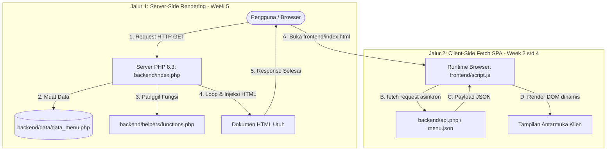

# web pemesanan makanan & minuman cafe berbasis qr code

halo, kami dari tim pengembang yang mengembangkan project web pemesanan makanan dan minuman berbasis QR code, dan ini adalah dokumentasi dari hasil yang kami kerjakan selama setengah semester

---

## Daftar Isi

- [Gambaran Umum](#gambaran-umum)
- [Arsitektur & Alur Data](#arsitektur--alur-data)
- [Struktur Repositori](#struktur-repositori)
- [Evolusi Teknis (Week 2 — Week 6)](#evolusi-teknis-week-2--week-6)
  - [Week 2: UI Semantik & Sistem Desain Responsif](#week-2-ui-semantik--sistem-desain-responsif)
    - [Task 01: Membangun Struktur HTML Semantik](#task-01-membangun-struktur-html-semantik)
    - [Task 02: Sistem Desain & Tata Letak Responsif](#task-02-sistem-desain--tata-letak-responsif)
    - [Task 03: Penyempurnaan Tampilan Antarmuka](#task-03-penyempurnaan-tampilan-antarmuka)
  - [Week 3: Arsitektur DOM & Interaksi Berbasis Event](#week-3-arsitektur-dom--interaksi-berbasis-event)
    - [Task 01: Memilih & Mengubah Elemen DOM](#task-01-memilih--mengubah-elemen-dom)
    - [Task 02: Menangani Event Pengguna](#task-02-menangani-event-pengguna)
    - [Task 03: Membangun Interaksi Paginasi Progresif](#task-03-membangun-interaksi-paginasi-progresif)
  - [Week 4: Integrasi REST API & Manajemen Status Asinkron](#week-4-integrasi-rest-api--manajemen-status-asinkron)
    - [Task 01: Menghubungkan Antarmuka ke REST API](#task-01-menghubungkan-antarmuka-ke-rest-api)
    - [Task 02: Menampilkan Data API secara Dinamis](#task-02-menampilkan-data-api-secara-dinamis)
    - [Task 03: Mengelola Siklus Status API (API State)](#task-03-mengelola-siklus-status-api-api-state)
  - [Week 5: Pemrosesan Server-Side & Rendering Dinamis (Procedural PHP)](#week-5-pemrosesan-server-side--rendering-dinamis-procedural-php)
    - [Task 01: Inisialisasi Halaman & Variabel Server-Side](#task-01-inisialisasi-halaman--variabel-server-side)
    - [Task 02: Pemrosesan Data Berbasis Array & Fungsi Helper](#task-02-pemrosesan-data-berbasis-array--fungsi-helper)
    - [Task 03: Server-Side Rendering (SSR) Kartu Menu Dinamis](#task-03-server-side-rendering-ssr-kartu-menu-dinamis)
  - [Week 6: Object-Oriented Programming — Class, Properties & Methods](#week-6-object-oriented-programming--class-properties--methods)
    - [Task 01: Mendefinisikan Class & Menginisialisasi Object](#task-01-mendefinisikan-class--menginisialisasi-object)
    - [Task 02: Properti Tertipe & Method Fungsional](#task-02-properti-tertipe--method-fungsional)
    - [Task 03: Menghasilkan Konten Dinamis Melalui Object](#task-03-menghasilkan-konten-dinamis-melalui-object)
- [Skema Data & Kontrak API](#skema-data--kontrak-api)
- [Spesifikasi Manajemen Status (State Management)](#spesifikasi-manajemen-status-state-management)
- [Panduan Pengembangan Lokal](#panduan-pengembangan-lokal)
- [Konvensi Kode & Standar Rekayasa Perangkat Lunak](#konvensi-kode--standar-rekayasa-perangkat-lunak)

---

## Gambaran Umum

Tujuan utama proyek ini adalah membangun fondasi arsitektur perangkat lunak web yang tangguh, modular, dan terstandardisasi industri. Repositori ini mendemonstrasikan penguasaan spektrum penuh web engineering:
- **Client-Side Engineering:** HTML5 semantik, sistem utility styling dengan Tailwind CSS, penanganan event DOM, dan integrasi fetch asinkron.
- **Server-Side Engineering:** Eksekusi kode di server lokal (PHP 8.3), pemisahan layer data dan helper functions prosedural, serta Server-Side Rendering (SSR) yang efisien.
- **Continuous Evolution:** Transformasi bertahap dari aplikasi satu halaman (*Single-Page Application*) menuju arsitektur berorientasi objek (*OOP*) dan pola *Model-View-Controller* (MVC).

### Karakteristik Arsitektur Utama
- **Zero-Build Architecture:** Seluruh kode dapat dijalankan langsung di browser dan server PHP tanpa dependensi bundler atau proses build yang rumit.
- **Pemisahan Tanggung Jawab yang Ketat (*Separation of Concerns*):** Lapisan data (`backend/data/`), lapisan logika/helper (`backend/helpers/`), lapisan presentasi klien (`frontend/`), dan lapisan presentasi server (`backend/index.php`) terisolasi secara disiplin.
- **Dual-Engine Operation:** Mendukung dua paradigma akses: mode *Client-Side SPA* via Fetch API dan mode *Server-Side Rendering* (SSR) murni via PHP.

---

## Arsitektur & Alur Data

Diagram berikut mengilustrasikan dua jalur pemrosesan data yang didukung oleh sistem:



---

## Struktur Repositori

Repositori mengadopsi struktur monorepo bertingkat yang bersih dan terisolasi:

```
tugas-pemrograman-web/
├── frontend/                  # Klien Web Statis (Pencapaian Week 2 s/d Week 4)
│   ├── asset/                 # Aset visual produk
│   ├── index.html             # Struktur semantik DOM dan konfigurasi Tailwind CSS
│   └── script.js              # Logika bisnis klien, event listeners, dan Fetch API
│
├── backend/                   # Arsitektur Server-Side (Pencapaian Week 5 & Week 6)
│   ├── asset/                 # Aset visual untuk kebutuhan server lokal
│   ├── classes/
│   │   └── Menu.php           # Class Menu: typed properties, constructor, getter & methods
│   ├── data/
│   │   ├── menu.json          # Sumber data tiruan legacy JSON
│   │   └── data_menu.php      # Master data array PHP terstruktur
│   ├── helpers/
│   │   └── functions.php      # Kumpulan fungsi murni (formatRupiah, saringMenu)
│   ├── api.php                # Endpoint REST API JSON untuk konsumsi klien
│   └── index.php              # Server-Side Rendering (SSR) + OOP entrypoint utama
│
├── material/                  # Materi dan panduan perkuliahan
├── .gitignore                 # Filter berkas lingkungan dan editor
└── README.md                  # Dokumentasi teknis proyek
```

---

## Evolusi Teknis (Week 2 — Week 6)

Setiap minggu perkuliahan berfokus pada 3 tugas utama (*Task 01, Task 02, dan Task 03*) yang dikerjakan secara sistematis.

---

### Week 2: UI Semantik & Sistem Desain Responsif

Fokus Week 2 adalah membangun fondasi visual antarmuka web yang kokoh, semantik, dan adaptif di berbagai resolusi layar.

#### Task 01: Membangun Struktur HTML Semantik
Mengonstruksi tata letak halaman menggunakan elemen semantik HTML5 standar untuk memastikan kejelasan hierarki dokumen dan aksesibilitas:
- Menggunakan elemen `<main>` sebagai wadah konten utama aplikasi.
- Menggunakan elemen `<aside>` untuk ringkasan keranjang belanja floating.
- Menggunakan elemen `<input>` dan `<button>` dengan identitas yang jelas untuk interaktivitas.

```html
<div class="max-w-7xl mx-auto px-6 py-12 flex flex-col lg:flex-row gap-12 relative min-h-screen">
    <main class="flex flex-col items-center w-full flex-1">
        <h1 class="font-serif text-4xl md:text-5xl lg:text-6xl font-extrabold text-[#1A110A] mb-2 tracking-tight capitalize">Menu</h1>
        <p class="text-xs md:text-sm font-medium text-[#5C4A3D] mb-6 md:mb-8 text-center px-4">Pesan langsung dari meja kamu</p>
        
        <div class="w-full max-w-2xl mb-6 md:mb-8 relative px-4 md:px-0">
            <input id="input-pencarian" type="text" placeholder="Cari makanan, minuman...">
        </div>
        
        <div id="menu-container" class="grid grid-cols-2 lg:grid-cols-3 gap-3 md:gap-6 w-full max-w-5xl px-2 md:px-0"></div>
    </main>
</div>
```

#### Task 02: Sistem Desain & Tata Letak Responsif
Mengonfigurasi tema desain dan sistem tata letak responsif menggunakan Tailwind CSS:
- Mendefinisikan palet warna kustom bernuansa hangat (*earthy warm palette*).
- Menetapkan tipografi ganda: *Playfair Display* untuk elemen judul dan *Plus Jakarta Sans* untuk teks isi.
- Menerapkan tata letak responsif: 2 kolom pada layar ponsel (`grid-cols-2`) dan 3 kolom pada layar komputer (`lg:grid-cols-3`) tanpa tumpahan horizontal (*zero horizontal overflow*).

```javascript
tailwind.config = {
  theme: {
    extend: {
      colors: {
        'primary-light': '#D5B99F',
        'dark': '#1A110A',
        'gray-500': '#5C4A3D',
        'gray-800': '#2C1E16',
      },
      fontFamily: {
        'sans': ['"Plus Jakarta Sans"', 'sans-serif'],
        'serif': ['"Playfair Display"', 'serif'],
      }
    }
  }
}
```

#### Task 03: Penyempurnaan Tampilan Antarmuka
Menyempurnakan detail visual antarmuka agar terasa premium:
- Menerapkan efek kaca transparan (*glassmorphism*) dengan kelas `bg-white/30` dan `backdrop-blur-sm`.
- Menambahkan transisi halus pada kartu menu saat disentuh kursor (`hover:scale-105 transition-transform duration-500`).
- Menyusun kartu produk yang rapi dengan pembagian visual antara wadah gambar dan informasi harga.

---

### Week 3: Arsitektur DOM & Interaksi Berbasis Event

Fokus Week 3 adalah mengimplementasikan logika interaktivitas pengguna berbasis JavaScript murni (ES6+) tanpa bantuan pustaka pihak ketiga.

#### Task 01: Memilih & Mengubah Elemen DOM
Mengambil referensi elemen DOM secara terprediksi dan mengontrol manipulasi tampilan:
- Mengambil elemen menggunakan `document.getElementById()` dan `document.querySelectorAll()`.
- Mengontrol penambahan dan penghapusan kelas Tailwind (`classList.add`, `classList.remove`) untuk menandai tombol kategori yang sedang aktif.

```javascript
const menuContainer = document.getElementById("menu-container");
const tombolNavigasi = document.getElementById("navigasi");
const tombolKategori = document.querySelectorAll('#filter-container button');

function updateGayaTombolAktif(tombolDiklik) {
    tombolKategori.forEach(tombol => {
        tombol.classList.remove("font-bold", "border-b-2", "border-[#1A110A]");
        tombol.classList.add("font-medium", "text-[#5C4A3D]");
    });
    tombolDiklik.classList.remove("font-medium", "text-[#5C4A3D]");
    tombolDiklik.classList.add("font-bold", "border-b-2", "border-[#1A110A]");
}
```

#### Task 02: Menangani Event Pengguna
Memasang pendengar event (*event listeners*) untuk merespons tindakan pengguna secara instan:
- **Event `click` pada filter:** Memperbarui variabel kategori aktif dan memicu penyaringan data ulang.
- **Event `keyup` pada pencarian:** Mendeteksi tombol `Enter` untuk mengeksekusi pencarian teks.
- **Event `input` pada pencarian:** Mengembalikan tampilan ke kondisi penuh ketika input teks dikosongkan.
- **Event `resize` pada jendela:** Menyesuaikan ambang batas jumlah kartu awal saat orientasi atau ukuran layar berubah.

```javascript
tombolKategori.forEach(tombol => {
    tombol.addEventListener('click', () => {
        kategoriAktif = tombol.dataset.kategori;
        updateGayaTombolAktif(tombol);
        jumlahTampil = batasAwal;
        renderMenu();
    });
});

inputPencarian.addEventListener('keyup', (e) => {
    if (e.key === 'Enter') {
        kataKunci = e.target.value.trim();
        jumlahTampil = batasAwal;
        renderMenu();
    }
});
```

#### Task 03: Membangun Interaksi Paginasi Progresif
Membangun fitur interaksi utuh berupa mesin paginasi dinamis:
- Menghitung kuota awal kartu berdasarkan lebar layar: 6 item di desktop (`window.innerWidth >= 1024`) dan 4 item di perangkat seluler.
- Menambahkan 4 kartu baru setiap kali tombol "Lihat Lebih Banyak" diklik.
- *Reversible Mechanism:* Ketika seluruh data dalam kategori telah terbuka, teks tombol bertransformasi menjadi "Tutup Kembali", yang mereset jumlah tampilan kembali ke kuota awal jika ditekan.

```javascript
tombolNavigasi.addEventListener('click', () => {
    let dataSaringan = kategoriAktif === "All" ? dataMenu : dataMenu.filter(item => item.kategori === kategoriAktif);
    if (kataKunci !== "") {
        dataSaringan = dataSaringan.filter(item => item.nama.toLowerCase().includes(kataKunci.toLowerCase()));
    }

    if (jumlahTampil >= dataSaringan.length) {
        jumlahTampil = batasAwal;
    } else {
        jumlahTampil += 4;
    }
    renderMenu();
});
```

---

### Week 4: Integrasi REST API & Manajemen Status Asinkron

Fokus Week 4 adalah memisahkan data dari kode program dan mengelola status asinkron pemanggilan jaringan (*network states*).

#### Task 01: Menghubungkan Antarmuka ke REST API
Mengintegrasikan sumber data eksternal menggunakan fungsi `fetch()` asinkron:
- Mengimplementasikan pola `async/await` yang bersih dan mudah dibaca.
- Memeriksa validitas kode status HTTP menggunakan `response.ok` sebelum memproses data.
- Mengonversi *stream* respon jaringan menjadi objek JSON JavaScript asli.

```javascript
async function ambilDataMenu() {
    try {
        const response = await fetch('../backend/menu.json');
        if (!response.ok) {
            throw new Error("Gagal mengambil data dari server");
        }
        dataMenu = await response.json();
        renderMenu();
    } catch (error) {
        console.error("Terjadi galat:", error);
    }
}
```

#### Task 02: Menampilkan Data API secara Dinamis
Mengolah data JSON dan merendernya menjadi elemen antarmuka secara dinamis:
- Menerapkan fungsi penyaringan ganda (*chained filtering*): kategori produk dan kecocokan kata kunci nama.
- Memotong array data sesuai indeks paginasi aktif (`dataSaringan.slice(0, jumlahTampil)`).
- Menginjeksi markup HTML kartu menu menggunakan *template literals* secara efisien ke dalam `#menu-container`.

```javascript
let dataTampil = dataSaringan.slice(0, jumlahTampil);
menuContainer.innerHTML = '';

dataTampil.forEach(item => {
    const kartuMenu = `
        <div class="flex flex-col bg-white/30 border border-[#1A110A]/10 rounded-2xl overflow-hidden shadow-lg backdrop-blur-sm">
            <div class="bg-[#1A110A] p-2 md:p-4">
                
            </div>
            <div class="flex flex-col items-center p-3 md:p-6 text-center">
                <h3 class="font-serif text-base md:text-2xl font-bold text-[#1A110A] mb-3">${item.nama}</h3>
                <button class="w-full py-2 bg-transparent border border-[#1A110A]/30 font-semibold rounded-lg">
                    Order Now (Rp ${item.harga})
                </button>
            </div>
        </div>
    `;
    menuContainer.insertAdjacentHTML('beforeend', kartuMenu);
});
```

#### Task 03: Mengelola Siklus Status API (API State)
Mengimplementasikan arsitektur status menyeluruh untuk menjamin keandalan sistem terhadap berbagai kondisi jaringan:
- **Loading State:** Mengaktifkan `#loading-state` dengan animasi putar saat transmisi data berlangsung, sekaligus menyembunyikan kontainer menu.
- **Success State:** Mematikan indikator loading dan menampilkan grid menu secara mulus.
- **Empty State:** Mengaktifkan `#empty-state` dengan pesan "Yang kamu cari tidak ditemukan" ketika hasil filter bernilai 0.
- **Error State:** Mengisolasi kegagalan jaringan di dalam blok `catch`, menampilkan pesan "#error-state" berlatar teks peringatan, serta menyediakan tombol aksi pemulihan (*reload recovery*).

```javascript
async function ambilDataMenu() {
    loadingState.classList.remove('hidden');
    loadingState.classList.add('flex');
    errorState.classList.add('hidden');
    menuContainer.classList.add('hidden');
    tombolNavigasi.style.display = 'none';
    
    try {
        const response = await fetch('../backend/menu.json');
        if (!response.ok) throw new Error("Gagal mengambil data");
        
        dataMenu = await response.json();

        loadingState.classList.add('hidden');
        loadingState.classList.remove('flex');
        renderMenu();
    } catch (error) {
        console.error("Terjadi kesalahan:", error);
        loadingState.classList.add('hidden');
        loadingState.classList.remove('flex');
        errorState.classList.remove('hidden');
        errorState.classList.add('flex');
    }
}
```

---

### Week 5: Pemrosesan Server-Side & Rendering Dinamis (Procedural PHP)

Fokus Week 5 adalah memindahkan beban pemrosesan data dan rendering antarmuka ke sisi server menggunakan bahasa pemrograman PHP prosedural modern (PHP 8.3).

#### Task 01: Inisialisasi Halaman & Variabel Server-Side
Membangun halaman utama server-side (`backend/index.php`) yang dieksekusi di server lokal:
- Menyiapkan variabel identitas toko/aplikasi (`$namaToko`, `$sloganToko`, `$statusOperasional`).
- Membaca parameter query string peramban (`$_GET['kategori']`) untuk menentukan kategori aktif secara server-side.
- Memastikan output HTML valid dengan struktur semantik yang utuh saat dokumen dikirimkan ke peramban.

```php
require_once __DIR__ . '/data/data_menu.php';
require_once __DIR__ . '/helpers/functions.php';

$namaToko = 'Menu';
$sloganToko = 'Pesan langsung dari meja kamu';
$kategoriAktif = $_GET['kategori'] ?? 'All';

$menuTampil = saringMenuByKategori($daftarMenu, $kategoriAktif);
$totalItemTampil = hitungTotalMenu($menuTampil);
$daftarKategori = dapatkanDaftarKategori($daftarMenu);
```

#### Task 02: Pemrosesan Data Berbasis Array & Fungsi Helper
Membangun lapisan data dan logika modular terisolasi:
- **Data Layer (`backend/data/data_menu.php`):** Menyimpan array multidimensi 30 item menu dengan atribut `id`, `nama`, `kategori`, `harga`, `gambar`, dan `status`.
- **Logic Layer (`backend/helpers/functions.php`):** Kumpulan fungsi murni (*pure functions*) tanpa kode HTML campuran:
  - `formatRupiah(int $nominal): string` untuk format mata uang lokal.
  - `saringMenuByKategori(array $menu, string $kategori): array` untuk filter data berdasarkan kategori.
  - `hitungTotalMenu(array $menu): int` untuk menghitung kuantitas data aktif.
  - `dapatkanDaftarKategori(array $menu): array` untuk mengekstrak kategori unik secara dinamis.

```php
function formatRupiah(int $nominal): string
{
    return "Rp " . number_format($nominal, 0, ',', '.');
}

function saringMenuByKategori(array $menu, string $kategori): array
{
    if ($kategori === 'All' || empty($kategori)) {
        return $menu;
    }

    return array_values(array_filter($menu, function ($item) use ($kategori) {
        return strtolower($item['kategori']) === strtolower($kategori);
    }));
}
```

#### Task 03: Server-Side Rendering (SSR) Kartu Menu Dinamis
Menghasilkan antarmuka kartu menu secara dinamis menggunakan perulangan `foreach` murni dari server dengan styling yang 100% identik dengan antarmuka frontend:
- Tidak ada elemen kartu menu yang diketik manual di berkas HTML.
- Struktur tata letak grid, kartu rounded, padding, dan efek hover pada gambar mengadopsi 100% token Tailwind CSS yang sudah ada sebelumnya.
- Menghasilkan tautan filter kategori yang bekerja langsung via request HTTP GET (`?kategori=Makanan`, `?kategori=Minuman`).

```php
<div id="menu-container" class="grid grid-cols-2 lg:grid-cols-3 gap-3 md:gap-6 w-full max-w-5xl px-2 md:px-0">
    <?php foreach ($menuTampil as $item): ?>
        <div class="flex flex-col bg-white/30 border border-[#1A110A]/10 rounded-2xl overflow-hidden shadow-lg hover:shadow-xl transition-shadow backdrop-blur-sm">
            <div class="bg-[#1A110A] p-2 md:p-4">
                <div class="w-full aspect-square rounded-xl overflow-hidden shadow-inner">
                    " 
                         alt="<?= htmlspecialchars($item['nama']); ?>" 
                         class="w-full h-full object-cover hover:scale-105 transition-transform duration-500">
                </div>
            </div>
            <div class="flex flex-col items-center p-3 md:p-6 text-center">
                <h3 class="font-serif text-base md:text-2xl font-bold text-[#1A110A] mb-3 md:mb-6 leading-tight"><?= htmlspecialchars($item['nama']); ?></h3>
                <button class="w-full py-1.5 px-2 md:py-3 md:px-4 text-xs md:text-base bg-transparent border md:border-2 border-[#1A110A]/30 text-[#1A110A] font-semibold rounded-lg md:rounded-xl hover:bg-[#1A110A] hover:text-[#D5B99F] transition-all duration-300">
                    Order Now (<?= formatRupiah($item['harga']); ?>)
                </button>
            </div>
        </div>
    <?php endforeach; ?>
</div>
```

---

### Week 6: Object-Oriented Programming — Class, Properties & Methods

Fokus Week 6 adalah merefaktor lapisan data dan presentasi dari paradigma prosedural ke paradigma berorientasi objek (*Object-Oriented Programming*), mengikuti prinsip *encapsulation* dan *single responsibility*.

#### Task 01: Mendefinisikan Class & Menginisialisasi Object
Membuat entitas `Menu` sebagai sebuah Class PHP yang terstruktur dan bertipe tegas:
- Mendefinisikan Class `Menu` dengan 6 properti privat bertipe (`int` dan `string`).
- Mengimplementasikan `__construct()` dengan 6 parameter bertipe untuk menjamin integritas data saat instansiasi.
- Mengonversi seluruh array data menu prosedural menjadi kumpulan objek `Menu` menggunakan `array_map()`.

```php
class Menu
{
    private int $id;
    private string $nama;
    private string $gambar;
    private int $harga;
    private string $kategori;
    private string $status;

    public function __construct(
        int $id,
        string $nama,
        string $gambar,
        int $harga,
        string $kategori,
        string $status
    ) {
        $this->id = $id;
        $this->nama = $nama;
        $this->gambar = $gambar;
        $this->harga = $harga;
        $this->kategori = $kategori;
        $this->status = $status;
    }
}
```

#### Task 02: Properti Tertipe & Method Fungsional
Menambahkan seluruh lapisan akses dan logika bisnis sebagai method yang terenkapsulasi di dalam class:
- **Getter Methods:** `getId()`, `getNama()`, `getGambar()`, `getHarga()`, `getKategori()`, `getStatus()` untuk akses properti privat yang aman.
- **Computed Methods:** `getHargaFormatted(): string` untuk format mata uang, menggantikan pemanggilan fungsi global `formatRupiah()`.
- **Boolean State Methods:** `isBestSeller()`, `isPromo()`, dan `isHabis()` sebagai query status item yang ekspresif dan mudah dibaca.
- **Profile Method:** `getProfile(): array` mengembalikan ringkasan data terstruktur dari object.

```php
public function getHargaFormatted(): string
{
    return 'Rp ' . number_format($this->harga, 0, ',', '.');
}

public function isBestSeller(): bool
{
    return strtolower($this->status) === 'best seller';
}

public function getProfile(): array
{
    return [
        'id'       => $this->id,
        'nama'     => $this->nama,
        'kategori' => $this->kategori,
        'harga'    => $this->getHargaFormatted(),
        'status'   => $this->status,
    ];
}
```

#### Task 03: Menghasilkan Konten Dinamis Melalui Object
Memanfaatkan method `renderKartu(): string` untuk menghasilkan seluruh markup HTML kartu produk dari dalam object itu sendiri — memisahkan logika presentasi kartu dari template halaman:
- Badge status (`Best Seller`, `Promo`, `Habis`) dihasilkan secara kondisional oleh method object menggunakan `isBestSeller()`, `isPromo()`, dan `isHabis()`.
- Item dengan status `Habis` secara otomatis menonaktifkan tombol dan menerapkan efek visual `opacity-60`.
- Template halaman `backend/index.php` menjadi bersih — loop hanya memanggil satu method, bukan memanipulasi array secara langsung.

```php
$objectMenu = array_map(function (array $item): Menu {
    return new Menu(
        $item['id'],
        $item['nama'],
        $item['gambar'],
        $item['harga'],
        $item['kategori'],
        $item['status']
    );
}, $menuTampil);
```

```php
<div id="menu-container" class="grid grid-cols-2 lg:grid-cols-3 gap-3 md:gap-6 w-full max-w-5xl px-2 md:px-0">
    <?php foreach ($objectMenu as $menu): ?>
        <?= $menu->renderKartu(); ?>
    <?php endforeach; ?>
</div>
```

---

## Skema Data & Kontrak API

Berkas data tiruan dan master data PHP mengikuti standar representasi entitas berikut:

```json
[
  {
    "id": 1,
    "nama": "white coffie",
    "gambar": "asset/white coffie.jpeg",
    "harga": 25000,
    "kategori": "Minuman",
    "status": "Best Seller"
  }
]
```

### Definisi Atribut Data

| Atribut | Tipe Data | Deskripsi |
| :--- | :--- | :--- |
| `id` | `integer` | Pengidentifikasi unik untuk setiap item menu |
| `nama` | `string` | Nama resmi menu kuliner yang ditampilkan |
| `kategori` | `string` | Label klasifikasi menu (`"Makanan"`, `"Minuman"`, `"Snack"`) |
| `harga` | `integer` | Nilai nominal harga dalam satuan Rupiah |
| `gambar` | `string` | Lokasi path relatif berkas gambar visual |
| `status` | `string` | Status operasional item (`"Tersedia"`, `"Promo"`, `"Best Seller"`, `"Habis"`) |

---

## Spesifikasi Manajemen Status (State Management)

Pada mode Client-Side (Week 4), antarmuka beroperasi menyerupai mesin status terhingga (*Finite State Machine*) dengan empat status utama:

```
┌───────────────┐
│     IDLE      │
└───────┬───────┘
        │ Inisialisasi awal
        ▼
┌───────────────┐        Fetch Sukses        ┌───────────────┐
│    LOADING    ├───────────────────────────►│    SUCCESS    │
└───────┬───────┘                            └───────┬───────┘
        │                                            │
        │ Fetch Gagal / Galat                        │ Data Ditemukan = 0
        ▼                                            ▼
┌───────────────┐                            ┌───────────────┐
│     ERROR     │                            │     EMPTY     │
└───────────────┘                            └───────────────┘
```

1. **`LOADING`**: Komponen `#loading-state` aktif; kontainer menu dan navigasi disembunyikan.
2. **`SUCCESS`**: Komponen `#menu-container` dirender dengan data dinamis; navigasi disesuaikan dengan kuota data.
3. **`EMPTY`**: Komponen `#empty-state` aktif ketika hasil saringan data bernilai `0`.
4. **`ERROR`**: Komponen `#error-state` aktif dengan tombol pemulihan jika komunikasi data terputus.

---

## Panduan Pengembangan Lokal

### Kebutuhan Sistem
- PHP versi 8.1 ke atas (Disarankan: PHP 8.3 via Laragon atau instalasi mandiri).
- Peramban web modern (Google Chrome, Mozilla Firefox, Microsoft Edge, Safari).

### Menjalankan Proyek Secara Lokal

#### 1. Week 5 & Week 6 — Server-Side Rendering + OOP (PHP)
Gunakan server bawaan PHP untuk menjalankan aplikasi backend dari root repositori:
```bash
php -S localhost:8000
```
Buka peramban pada:
- `http://localhost:8000/backend/` — Halaman utama SSR dengan rendering OOP.
- `http://localhost:8000/backend/?kategori=Makanan` — Filter kategori via query string.
- `http://localhost:8000/backend/?q=kopi` — Pencarian kata kunci via query string.

#### 2. Week 2 s/d Week 4 — Client-Side SPA (Fetch API)
Jalankan server dari root proyek untuk mengakses antarmuka klien:
```bash
php -S localhost:8000
```
Buka peramban pada alamat: `http://localhost:8000/frontend/index.html`

#### 3. Menguji Endpoint REST API
Untuk memeriksa keluaran JSON dari backend PHP:
Buka peramban pada alamat: `http://localhost:8000/backend/api.php` atau `http://localhost:8000/backend/api.php?kategori=Makanan`

---

## Konvensi Kode & Standar Rekayasa Perangkat Lunak

Seluruh pengembangan mematuhi standar teknis berikut untuk menjaga kematangan arsitektur menuju Week 7 (MVC):

1. **Separation of Concerns:** Pemisahan tegas antara lapisan data (`backend/data/`), lapisan entitas objek (`backend/classes/`), lapisan fungsi murni (`backend/helpers/`), dan lapisan presentasi antarmuka (`backend/index.php` dan `frontend/`).
2. **Encapsulation & OOP Principles:** Seluruh properti class dideklarasikan `private` dan hanya dapat diakses melalui getter method yang terekspos secara publik. Logika bisnis (format harga, status item) dikapsulasikan di dalam method class.
3. **Strict Typings & PHP 8 Practices:** Menggunakan deklarasi tipe data yang ketat pada seluruh argumen, return value, dan properti class (`int`, `string`, `bool`, `array`).
4. **Penyaringan XSS Server-Side:** Seluruh data yang di-render ke HTML wajib dilindungi menggunakan fungsi `htmlspecialchars()` untuk mencegah celah keamanan injeksi skrip.
5. **Disiplin Kode Bersih (*Clean Code*):** Tidak menyisakan komentar-komentar mati (*dead comments*), tidak menggunakan nama variabel samar, dan memastikan penamaan method/fungsi menggambarkan perilakunya secara eksplisit.
